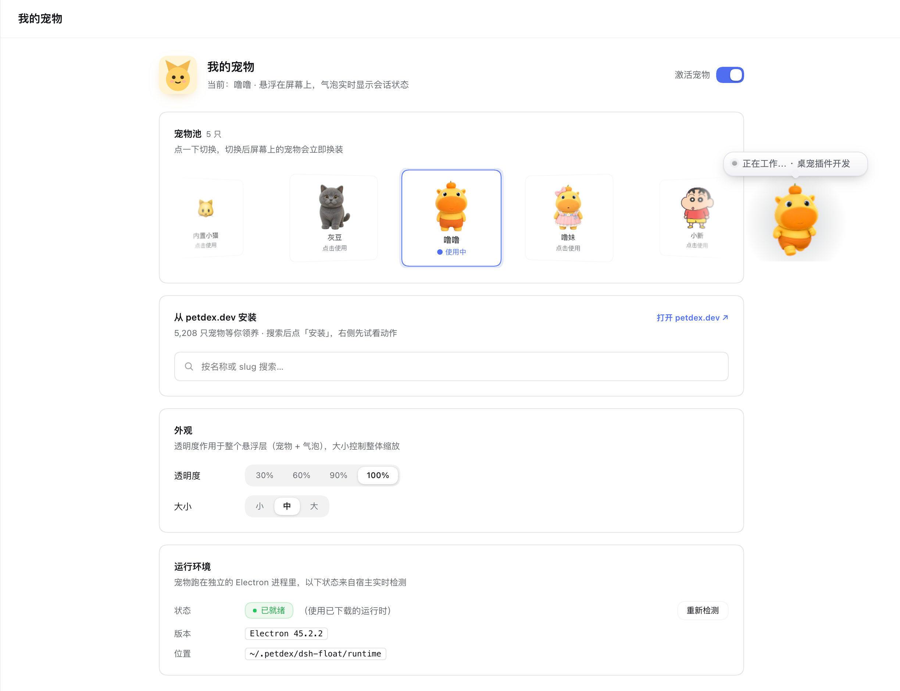

# dsh-desk-pet

[](https://www.npmjs.com/package/dsh-desk-pet-plugin)
[](./LICENSE)

一只悬浮在屏幕上的桌宠插件，为 [DeepSeek Harness](https://github.com/deepseek-ai/deepseek-harness) 而生。
A floating desk pet for DeepSeek Harness.



---

## 中文

### 它是什么

一只真正**站在你屏幕上**的宠物——不在网页里，而是一个独立的透明置顶浮窗进程：DSH 最小化、被遮挡、不在当前屏、甚至在全屏 App 之上，它都在。

它和别的桌宠插件不一样的地方：

- **会话状态长在它身上**：气泡圆点颜色 = 左侧会话列表的状态（运行中灰 / 等你操作琥珀 / 已完成绿），点气泡直接把 DSH 拉到前台并跳到那个会话
- **多显示器安心**：拔了副屏，它自动回主屏，不会丢在不存在的屏幕上
- **不当常驻后台**：开关一关，进程立刻杀掉；要用时一键回来
- **不静默下载**：运行环境缺失时先问你，确认才下载；若你先拨了开关，装完它会**自动激活**
- **宠物多到挑不完**：接入 [petdex.dev](https://petdex.dev) 社区图鉴，**5,200+ 只动画宠物**持续上新——奶龙、蜡笔小新、皮卡丘、水豚……每只都带待机/跑动/挥手/跳跃多套动作，安装前可以先试看

### 功能

- **实时状态**：气泡里带一个和左侧会话列表同色的圆点 —— 运行中（灰）、等待你操作/审批/回答（琥珀）、已完成（绿）
- **点击跳转**：点气泡把 DSH 拉到前台并打开对应会话（静默跳转，不弹提示）
- **拖拽**：拖到任意位置，松手自动吸附回屏幕内；多显示器支持——副屏拔线后宠物自动回主屏右下角
- **右键菜单**：`设置宠物` / `隐藏`（隐藏前会冒泡提示去「我的宠物」页面激活，3 秒后消失）
- **宠物池**：3D 轮播展示已装宠物，选中项居中；拖动/滚轮浏览，点击切换
- **在线安装**：内置小猫，或从 [petdex.dev](https://petdex.dev) 搜索安装社区动画宠物；安装前可先看动作预览（待机/跑动/挥手/跳跃）
- **外观**：透明度（30%–100%，默认 100%）与大小（小/中/大）实时生效
- **激活开关**：设置页一键显隐，点击即翻转；关闭立即杀进程，不留后台
- **深色模式**：跟随系统

### 安装

在 DSH 会话里（推荐，会同时装包并选入 profile）：

```
plugin_manager  action=install_bundle  target="dsh-desk-pet-plugin"
```

或命令行：

```bash
dsh plugin --profile <你的profile> add dsh-desk-pet-plugin
```

装完后 DSH 左侧边栏会出现「我的宠物」入口，点击打开设置页。

### 运行时（首次启用时会询问）

宠物是一个独立的 Electron 浮窗进程，需要一个 Electron 运行时。**不会静默下载**，流程是：

1. 打开设置页或激活宠物时先检查环境（不联网、不下载）
2. **本机已有可用的 Electron（≥ 28）→ 直接复用，跳过下载**
3. 缺失或版本过旧 → 弹窗询问（显示包名，不显示体积）→ 点「下载」才开始下载
4. 若你先拨了「激活宠物」再下载：**下载完成后自动激活**，宠物直接出现；点「取消」则清除意图，什么都不做

下载目标：

```
~/.petdex/dsh-float/runtime      # Electron 45.2.2，约 120 MB，来自 npmmirror
```

- 最低可用版本 **Electron 28**：低于此值不采用，会提示「运行环境需要更新」
- 已下载的运行时带版本戳；与内置版本不一致时同样提示更新
- 手动指定任意 Electron：`DESK_PET_ELECTRON=/path/to/Electron`
- 二进制读取版本时会剔除 `ELECTRON_RUN_AS_NODE`（否则会读到 Node 版本）

### 数据与网络

| 位置 / 目标 | 内容 |
|---|---|
| `~/.petdex/pets/` | 已安装的宠物素材（与 petdex CLI 同目录结构） |
| `~/.petdex/dsh-float/` | 运行时、窗口位置 `pos.json`、子进程 pid |
| `petdex.dev` / `assets.petdex.dev` | 只在打开图鉴、搜索、安装宠物时访问（由宿主代理，不受页面 CSP 限制） |
| `registry.npmmirror.com` | 仅首次下载 Electron 运行时 |

清空 `~/.petdex/` 即可完全移除残留数据。

### 平台

- **macOS**：已完整验证（含 Retina、多显示器热插拔、全屏 App 之上置顶、Dock 隐藏）
- **Windows / Linux**：代码路径已兼容但**未实测**，欢迎反馈

### 卸载

```
plugin_manager  action=remove_bundle  target="dsh-desk-pet-plugin"
```

卸载后侧栏入口和页面会立即移除。

---

## English

A desk pet that actually lives **on your screen** — not in a web page, but in its
own always-on-top transparent window process: it stays visible when DSH is
minimized, covered, on another space, even above full-screen apps.

What makes it different from other pet plugins:

- **Your session state lives on it** — the bubble dot mirrors the sidebar's
  session colors (running grey / waiting amber / done green), and clicking the
  bubble raises DSH straight into that session.
- **Multi-monitor safe** — unplug a display and the pet re-homes to your primary
  screen instead of vanishing into nowhere.
- **No background babysitter** — toggling it off kills the process instantly;
  one switch brings it back.
- **Never downloads silently** — a missing runtime asks first; if you had already
  flipped the switch, the pet activates itself the moment the download finishes.
- **An endless pet roster** — hooked into the [petdex.dev](https://petdex.dev)
  community catalog with **5,200+ animated pets** and counting: dragons, anime
  mascots, capybaras… each ships with idle / run / wave / jump action sets, and
  you can preview the moves before installing.

### Features

- **Live status** — the bubble carries a status dot whose colour matches the
  sidebar: running (grey), waiting for you (amber, incl. approvals/questions),
  finished (green).
- **Click to jump** — clicking the bubble raises DSH and opens that session.
- **Drag anywhere** — released windows snap back inside the screen; on
  multi-monitor setups the pet re-homes to the primary display when its
  display is unplugged.
- **Right-click menu** — `Pet settings` / `Hide`. Hiding shows a short bubble
  pointing to the settings page before the pet disappears.
- **Pet pool** — a 3D carousel of installed pets with the active one centered;
  drag or scroll to browse, click to switch.
- **Pet catalog** — search and install animated pets from
  [petdex.dev](https://petdex.dev) with an action preview (idle / run / wave /
  jump) before installing.
- **Appearance** — opacity (30–100 %, default 100 %) and size (S/M/L), applied
  live.
- **Activate switch** — show or hide the pet instantly; hiding kills the
  process, nothing stays in the background.
- **Dark mode** — follows the system appearance.

### Install

```
plugin_manager  action=install_bundle  target="dsh-desk-pet-plugin"
```

or

```bash
dsh plugin --profile <profile> add dsh-desk-pet-plugin
```

After installation, a **My pets** entry appears in the DSH sidebar and opens
the settings page.

### Runtime (asked once, never silent)

The pet runs in a separate Electron process and needs an Electron runtime:

1. Opening the settings page or activating the pet first checks the
   environment (no network, no download).
2. **A local Electron ≥ 28 is reused as-is — nothing is downloaded.**
3. Missing or too old → a card asks for confirmation (it names the package but
   shows no size) → only then does the download start.
4. If you had flipped the **Activate pet** switch before downloading, the pet
   activates automatically once the runtime is ready; **Cancel** clears that
   intent and does nothing.

Download target: `~/.petdex/dsh-float/runtime` (Electron `45.2.2`, ~120 MB from
npmmirror). Minimum accepted local version is **Electron 28**; an already
downloaded runtime carries a version stamp and is refreshed when it disagrees.
Override the binary with `DESK_PET_ELECTRON=/path/to/Electron`.

### Data

`~/.petdex/pets/` holds installed pet assets, `~/.petdex/dsh-float/` holds the
runtime, window position and child pid. Network access happens only when you
open the catalog, search, or install a pet (proxied through the Host so the page
CSP never applies), plus the one-time runtime download.

### Platform

macOS is fully verified (Retina, multi-display hot-plug, above full-screen
apps, Dock hidden); Windows and Linux paths exist but are untested.

### License

MIT © ZGJ
