# 桌面宠物 · 设置页样式优化方案

> 目标：**更简约、更耐看**，同时保留现有功能与 DSH 原生质感。
> 本文包含：现状诊断（带代码定位）→ 三版设计方案（含浅/深色设计稿）→ 对比与推荐 → 可直接落地的实施路线。
>
> 设计稿与渲染脚本都在本目录：`mockups/`（HTML）、`screens/`（2x PNG）、`render.sh`（本地重绘）。
> 所有截图为**真实数据**（本机安装的 6 只 petdex 宠物 + 内置小猫）与 **DSH 真实主题令牌**渲染。

---

## 0. 结论先行

1. **现状的问题不是"丑"，而是"没有规则"**：10 档正文字号、8 种圆角、5 个等重视觉重量的卡片、两层重复标题；彩色强调（近黑 brand）被同时用在边框、徽标、开关上，反而没有主次。**3D 切换本身要保留**，问题出在参数（22°/38px）和卡片里塞了 3 行小字（详见 3.7）。
2. **推荐方案 A（极简留白）作为主线**：改动集中在 `styles.js` + 3 个组件，1 天内可落地，一屏放下全部设置，气质最接近 DSH 原生页面。
3. **吸收 B 的"设置行"与 C 的"舞台/抽屉"**作为后续增强：B 的分组行适合宠物数量继续变多；C 的抽屉是安装流程的最佳载体（不打断当前页面）。
4. 无论选哪版，**先落地第 3 节的"基础规范"**：零结构改动，就能拿掉现状 60% 的"廉价感"（字阶、圆角、描边、内联样式）。

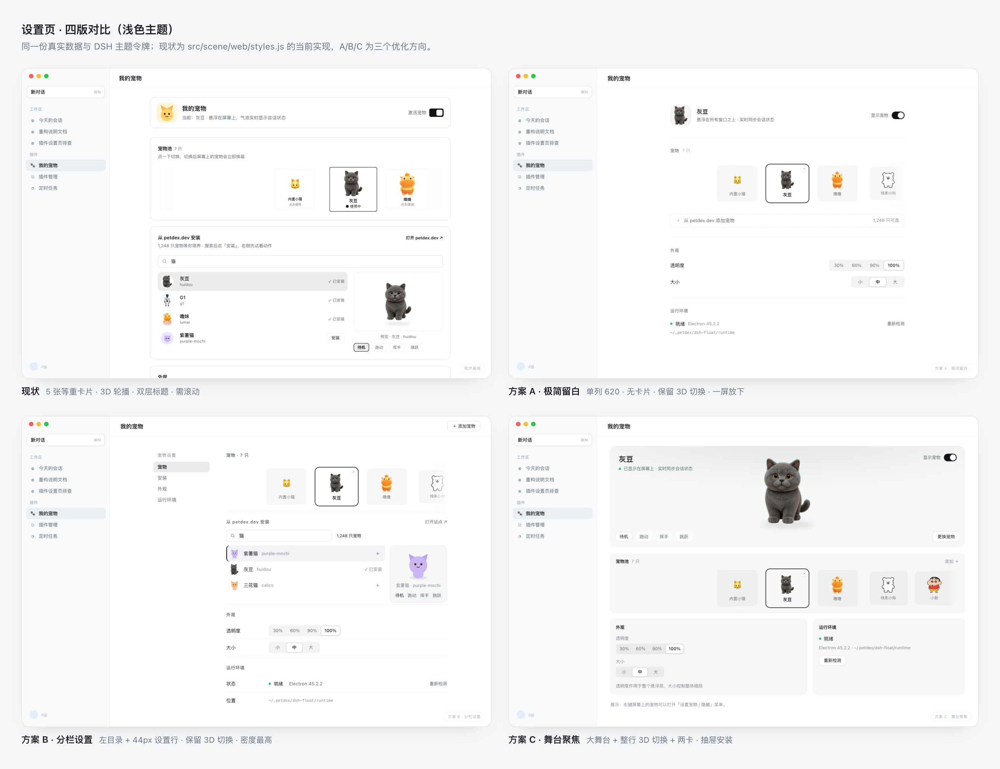

---

## 1. 现状基线

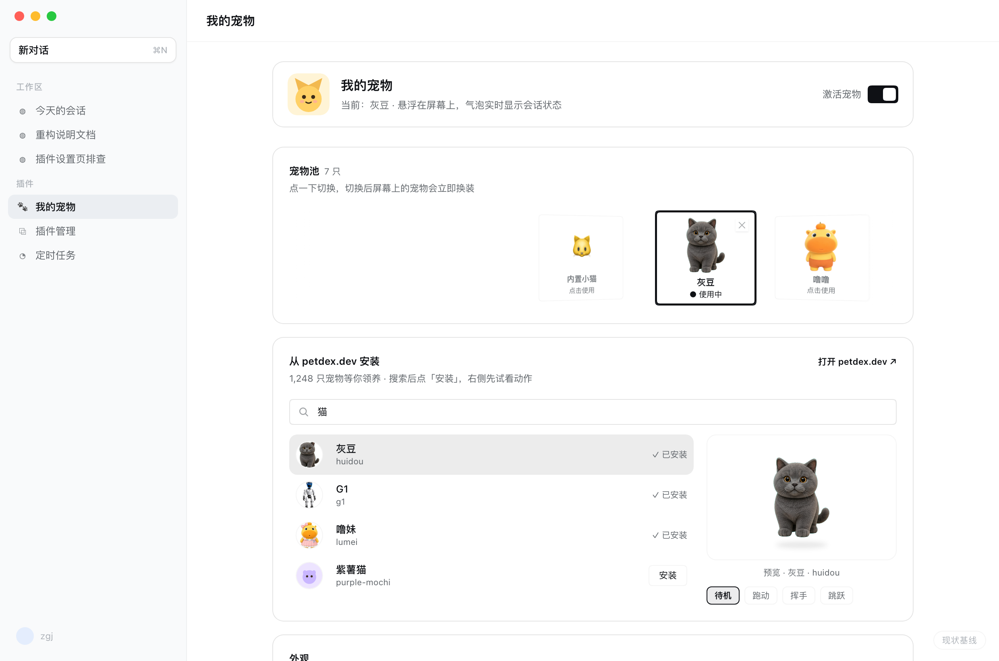
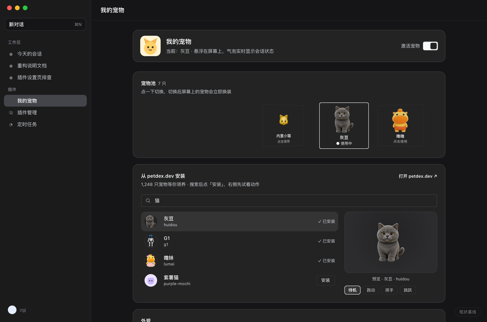

当前实现是一个 860px 宽的单列，由 5 个同规格的"描边卡片"组成：

| # | 区块 | 组件 | 说明 |
|---|------|------|------|
| 1 | Hero | `PetHero` | 内置猫图标 + 第二个"我的宠物"标题 + 开关 |
| 2 | 宠物池 | `PetPoolCard` | 3D 透视横向轮播（7 张卡，**保留**） |
| 3 | 安装 | `InstallCard` | 搜索 + 结果列表 + 动作预览舞台 |
| 4 | 外观 | `AppearanceCard` | 透明度 / 大小两行分段控件 |
| 5 | 运行环境 | `RuntimeCard` | 状态胶囊 + 版本 + 路径 + 重新检测 |

---

## 2. 诊断：15 个具体问题（按影响排序）

### 2.1 信息层级

**① 标题重复，一屏两个"我的宠物"**
`src/scene/web/pet-page.js:213`（topbar `h1` = `menuPet`）和 `src/scene/web/pet-page-cards.js:90`（hero `.dpp-t1` = `menuPet`）同时渲染"我的宠物"，hero 里那个 16px 标题没有任何新信息。

**② 5 个区块视觉重量完全相同**
`styles.js:97` 的 `.dpp-card`（`padding:20px` + `border-l2` + `radius:14px`）被复制 4 次，hero 也是同样的描边盒。低频的"运行环境"和高频的"当前宠物/开关"看起来一样重要，用户没有阅读主线。

**③ 浅色主题下"白底白卡"，只剩描边**
`--dsw-alias-bg-base` 与 `--dsw-alias-bg-layer-1` 在浅色下**都是 `#fff`**（DSH 内置主题 `dsh-client-ui-theme/styles/design-platform.css:179,183`）。`.dpp-card` 的 `background: var(--dsw-alias-bg-layer-1)` 等于没有，于是页面变成"一堆灰色线框"——这就是"廉价感"的主要来源。

**④ 一屏放不下**
`860px` 内容 + 5 个描边区块（每个 20px 内边距），在 1440×900 窗口里"运行环境"必须滚动才能看到（见基线截图右侧滚动条）。

### 2.2 排版与形状

**⑤ 正文字号 10 档，且相邻差 0.5px**
`styles.js` 里出现 `9.5 / 10 / 10.5 / 11 / 11.5 / 12 / 12.5 / 13.5 / 15 / 16`。其中 `11 / 11.5 / 12 / 12.5` 四档肉眼无法区分，层级实际只能靠位置猜。

**⑥ 圆角 8 种混用**
`0 / 5 / 6 / 8 / 10 / 12 / 14 / 999`（`styles.js` 全文）——圆角不再表达"元素类别"，只是随手写的数字。

**⑦ 控件不成体系**
- 开关轨道 `38×22`，圆角 8 + `corner-shape: squircle`（`styles.js:86`）
- 分段控件：`padding:3px`、`radius 8`、内部 `radius 6`（`styles.js:139-143`）
- 搜索框：`height:32`、`radius 8`、内部输入 `font-size:12`（`styles.js:148-154`）
- 按钮：`radius 8`、`padding 6px 16px`（`styles.js:47`）

四种控件、四套内边距/圆角/字号逻辑，拼在一起就"不齐"。

### 2.3 结构与交互

**⑧ 3D 轮播：交互要保留，参数和内容要收敛**
`perspective: 900px` + `rotateY(±22deg)` + `translateZ(-38px)` + `scale(0.93)`（`styles.js:108`、`pet-carousel.js:24`）——**这是产品的标志性交互，不删**，但当前参数偏激进：邻卡被压扁、文字发虚，拖拽时整排抖动；126×118 的卡里塞了 3 行字（名称 / 徽标 / 副文案），一倾斜就读不清。另外拖拽收尾有一个真实 bug（见 ⑭）。
优化方向不是去掉 3D，而是：**旋转 22°→16°、深度 38→28px、缩放 0.93→0.95、透明度下限 0.72→0.88；卡片从 3 行压到 2 行；惯性滚动改成磁性吸附**（3.7 节有参数对比图）。

**⑨ 移除按钮 hover 才出现**
`.dpp-pet .x { opacity: 0 }`，`hover` 才 `0.65`（`styles.js:131-135`）。触摸设备上等于不可见、不可用。

**⑩ 焦点态只覆盖了两个控件**
`styles.js:94` 只给 `.dpp-switch-track` 做了 `:focus-visible`，`.dpp-search` 只有 `:focus-within` 的边框；宠物卡是 `role="button" tabIndex=0`（`pet-carousel.js:184-185`），键盘用户看不到焦点在哪。

**⑪ 长路径没有截断策略**
`.dpp-kv code` 是 `grid` 第二列（`styles.js:176-181`），没有 `min-width:0` / `text-overflow`，`bin` 路径一长就把整行撑破。

### 2.4 代码卫生（顺手可清）

**⑫ 内联样式散落**
`pet-page-cards.js` 里有 10 处 `style: {...}`（状态胶囊、重检动画、搜索输入、空态提示等），导致"同一类文字"在不同位置字号不同。

**⑬ 死代码**
`pet-page.js:192-206` 定义了 `h2` / `desc` / `pill` 三个样式对象，**从未使用**，其中 `pill` 还是 `.dpp-pill` 的重复实现。

### 2.5 真实缺陷

**⑭ 拖拽收尾抛错（`pet-carousel.js:123`）**
`el.classList.onRemove("dragging")` —— `classList` 上没有 `onRemove` 方法，`pointerup` 时会抛 `TypeError`：`dragging` 类摘不掉（光标一直是 grabbing）、`window` 上的 `pointermove/pointerup` 监听器也不会被移除，每拖一次就泄漏一组；`stopInertia()` 同样被跳过。改成 `classList.remove(...)` 即可。

**⑮ 暗色下主按钮白底白字（真实 bug）**
`.dp-btn--primary { background: var(--dp-brand); color: #fff }`（`styles.js:54`），而 `--dp-brand → --dsw-alias-brand-primary` 在**暗色等于 `rgb(249,250,251)`**（DSH 内置主题 `design-platform.css:357`）——白字压在近白底上，对比度不足 1.1:1。运行时弹窗的"下载/重试"按钮因此几乎不可读。

> 补充：`--dsw-alias-brand-primary` 在浅色是近黑 `#0f1115`、深色是近白，它本质是**单色强调色**。现状把"彩色"和"强调"混为一谈：状态用绿色、强调用近黑，却又给徽标、边框、开关都上了 brand，等于处处强调 = 处处不强调。

---

## 3. 基础规范（三版共用，建议先落地）

这一层只改 CSS，不动结构，**1–2 小时**即可让整页"看起来对了"。

### 3.1 字阶：3 + 1 档

| Token | 值 | 用途 |
|---|---|---|
| `--dp-fs-title` | **15px / 600** | 宠物名、区块主标题、topbar |
| `--dp-fs-body` | **12.5px / 400** | 设置项 label、结果名、输入框 |
| `--dp-fs-small` | **11.5px / 400** | 说明、元信息、胶囊、tab |
| `--dp-fs-mono` | 10.5px | 等宽路径（仅等宽字体一档） |

行高统一 `1.45`；标题 `1.3`。**中文字号不要用 0.5px 递进**，12.5 与 11.5 之间的差异已经足够。

### 3.2 形状与线

| Token | 值 | 用途 |
|---|---|---|
| `--dp-r-sm` | 6px | 分段控件内块、小图标按钮 |
| `--dp-r-md` | 8px | 按钮、输入框、行 hover |
| `--dp-r-lg` | 12px | 缩略图、面板、预览舞台 |
| `--dp-r-xl` | 16px | 大舞台、头像 |
| `--dp-r-pill` | 999px | 状态胶囊、开关 |

- **线只有一种**：`--dsw-alias-border-l1`（浅 4% / 深 6%）。`border-l2` 只留给"可交互控件的边界"（输入框、按钮），不要用来画卡片。
- **表面不要用 `bg-layer-1` 当卡片底色**（浅色下就是白）。要么**无底色**（方案 A/B），要么用 `color-mix(in srgb, var(--dsw-alias-label-primary) 3~4%, transparent)` 的"轻着色"（方案 C，同一套色在深浅下都成立）。

### 3.3 交互状态

```css
/* hover / active / focus 统一走这三个令牌，不再手写 rgba */
.dp-row:hover   { background: var(--dsw-alias-interactive-bg-hover); }
.dp-row:active  { background: var(--dsw-alias-interactive-bg-active); }
.dp-row:focus-visible,
.dpp-pet:focus-visible {
  outline: 2px solid color-mix(in srgb, var(--dsw-alias-label-primary) 50%, transparent);
  outline-offset: 2px;
}
```

- 过渡只允许 `background / color / opacity / transform`，`120ms / 160ms ease-out`。
- 尊重 `prefers-reduced-motion: reduce`：关掉淡入与位移动画。

### 3.4 强调与状态

- **强调只用单色**（`--dsw-alias-label-primary`）：选中态 = 1.5px 描边或实底，不要再叠加彩色。
- **颜色只给状态**：成功 `--dsw-alias-state-success-primary`，警告 `warn`，错误 `error`；并且只出现在 6px 圆点或文字上。
- **主按钮改成反色**：`background: label-primary; color: bg-base`——顺带修掉 ⑮ 的暗色 bug。
- 状态胶囊的绿色文字对比度不足（`#22c55e` on white ≈ 2.3:1），建议改为「绿点 + 主文字色」，胶囊底色不要再用绿色淡染。

### 3.5 文案层（顺手统一）

| 现状 | 建议 |
|---|---|
| 每节都有一句 `dpp-desc` 解释（5 段） | 只保留"首次使用"提示；常驻说明收敛为 1 行，其余的放到 `title` 属性 |
| `宠物池` / `currentPet` / `pgPetsHint` 三处措辞不一 | 统一为「宠物池」「切换」「移除」 |
| slug 直接展示在结果行 | 只在预览标题里出现，列表行弱化为 11.5px 次要色 |
| 中英混排空格不一致（`从 petdex.dev 安装`） | 域名两侧保留空格，其余中文不加空格 |

### 3.6 建议的令牌落点

在 `styles.js` 顶部加一层 `--dp-*`（只做语义映射，不新增颜色字面量），后续三版都复用它：

```css
.desk-pet-page {
  --dp-fs-title: 15px;  --dp-fs-body: 12.5px;  --dp-fs-small: 11.5px;
  --dp-r-sm: 6px; --dp-r-md: 8px; --dp-r-lg: 12px; --dp-r-xl: 16px;
  --dp-line: var(--dsw-alias-border-l1);
  --dp-hover: var(--dsw-alias-interactive-bg-hover);
  --dp-surface: color-mix(in srgb, var(--dsw-alias-label-primary) 3.5%, transparent);
  --dp-focus: 0 0 0 2px color-mix(in srgb, var(--dsw-alias-label-primary) 45%, transparent);
}
```

### 3.7 3D 切换：保留，只收敛参数

**不动交互形态，只改参数和卡片内容。** 现状 → 建议：

| 参数 | 现状 | 建议 | 为什么 |
|---|---|---|---|
| 旋转 `rotateY` | 22° / 单位 | **16°** | 仍能看出纵深，文字不再明显压扁 |
| 深度 `translateZ` | 38px / 单位 | **28px** | 邻卡后退变浅，不"掉"进背景 |
| 缩放 `scale` | 0.93 | **0.95** | 邻卡名字仍可读 |
| 透明度 | 0.88（下限 0.72） | **0.92（下限 0.88）** | 边缘卡不会糊成一块 |
| 透视 `perspective` | 900px | **1000px** | 透视更平缓 |
| 最大旋转 | 不封顶（7 张卡时可达 ±88°，出现镜像） | **封顶 ±1.6 单位（≈26°）** | 远端卡不会翻面成镜像 |
| 卡片 | 126×118，3 行字 | **116×104，2 行（图 + 名称）** | 倾斜时字依然清楚 |
| 停位 | 惯性滑行 | **磁性吸附到最近卡** | 每次停在同一位置，可预期 |
| 移除按钮 | hover 才出现 | **当前卡常显 0.55，其余 hover 出现** | 触屏也能移除 |

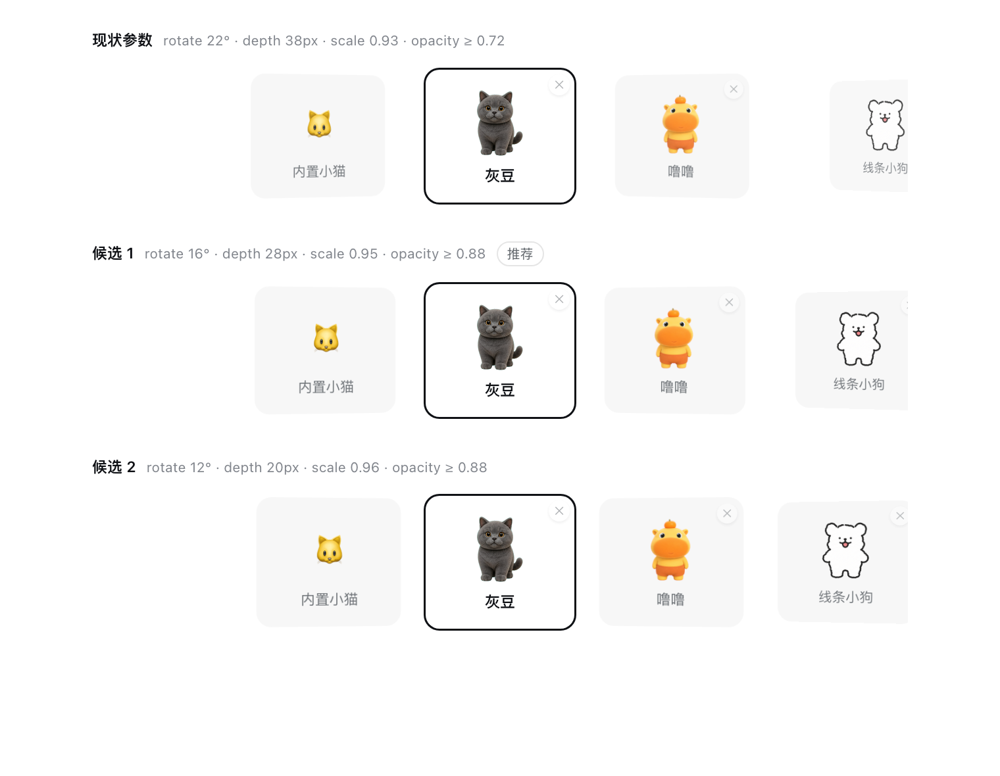

拖动过程中的中间态（两张卡各偏半格，字仍然清楚）：

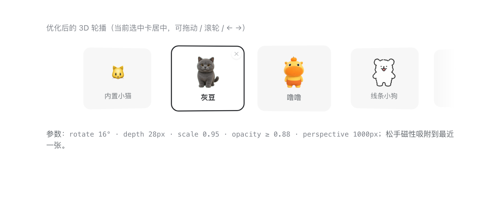

布局数学（与 `pet-carousel.js` 现有实现一致，只换常量）：

```js
const CFG = { rotate: 16, depth: 28, scale: 0.95, minOpacity: 0.88, fade: 0.08, clamp: 1.6 };
const span = 128;                                    // 卡宽 116 + gap 12
const t  = (centre - mid) / span;
const tc = Math.max(-CFG.clamp, Math.min(CFG.clamp, t)); // 旋转封顶
const a  = Math.min(Math.abs(t), 2);                     // 位移/缩放衰减封顶
card.style.transform =
  `rotateY(${-tc * CFG.rotate}deg) translateZ(${-a * CFG.depth}px) scale(${1 - a * (1 - CFG.scale)})`;
card.style.opacity = String(Math.max(CFG.minOpacity, 1 - a * CFG.fade));
```

交互细节（都在 `pet-carousel.js` 内改，不改组件 API）：

- **指针捕获 + 6px 阈值**：`setPointerCapture`，位移超过阈值才算拖拽，拖拽结束后吞掉一次合成 click，避免"拖完误切换"。
- **磁性吸附**：`pointerup` / 滚轮停手 160ms 后，`scrollTo({ left: centreOf(nearest) })`；`prefers-reduced-motion` 时改为瞬时定位。
- **键盘**：卡片可 Tab 聚焦，`←/→` 移动并居中，`Enter/Space` 选中；焦点环用 `label-primary 45%`。
- **修 ⑭**：`classList.onRemove` → `classList.remove`，并在 `pointercancel` 时也清掉 `dragging` 类与监听器。
- **给 `.dpp-strip` 加 `position: relative`**：保证 `card.offsetLeft` 相对滚动容器，居中计算不受外层布局影响。
- **卡片只留两行**：缩略图 + 名称；"使用中 / 点击使用"这行不再渲染，选中用 1.5px 内描边 + 字重表达（`active` / `use` 两个文案可保留作 `aria-label`，不影响现有 i18n 测试）。
- 可选兜底：`scroll-snap-type: x proximity` + `scroll-snap-align: center`，让触控板惯性也能落在卡上（不支持时不影响自定义吸附）。

---

## 4. 方案 A：极简留白（推荐主线）

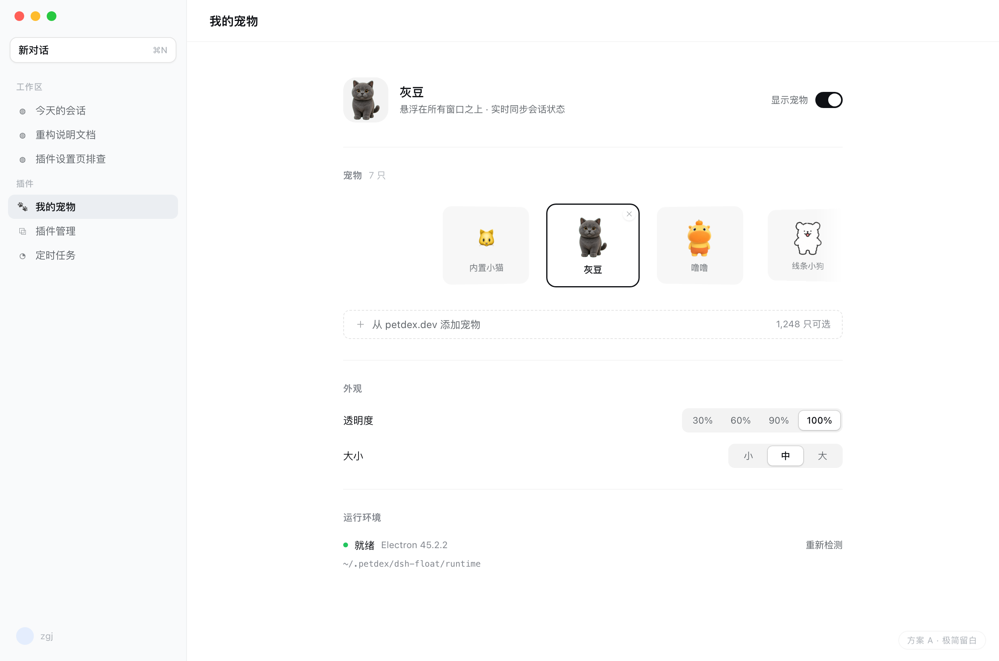
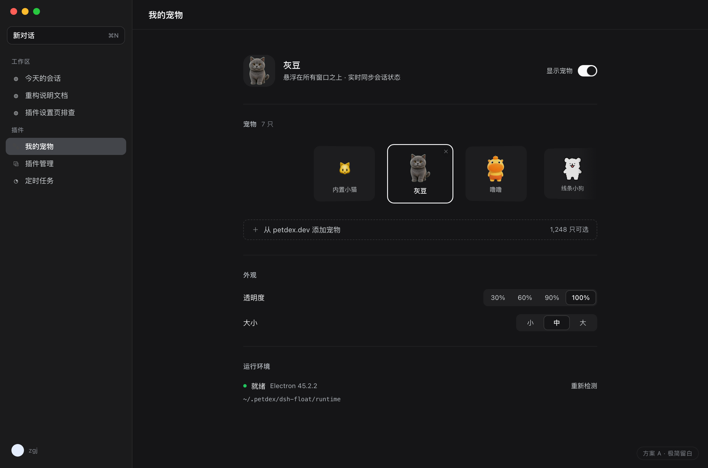

### 4.1 手法

1. **一条视觉轴**：620px 单列居中、内容左对齐，整页只有"标题 → 内容"这一种节奏。
2. **去掉所有卡片**：区块之间只用 `1px` 细线 + `26px` 上下留白分隔，页面立刻轻下来。
3. **一个标题**：topbar 保留"我的宠物"，hero 不再重复标题，改成「头像 + 名字 + 状态副标题 + 开关」的一行身份条。
4. **合并区块**：宠物池与安装合成一个「宠物」区——安装收成一行"＋ 从 petdex.dev 添加宠物"，点开就地展开搜索/结果/预览（渐进披露，见下张图）。
5. **宠物池保留 3D 切换**：形态不变，只把参数收敛到 16°/28px、卡片压到 2 行（见 3.7）。
6. **运行环境降级**：从卡片降为页脚两行——`● 就绪  Electron 45.2.2` + 等宽路径 + 右侧"重新检测"。既保留信息，又不再和高频设置抢注意力。

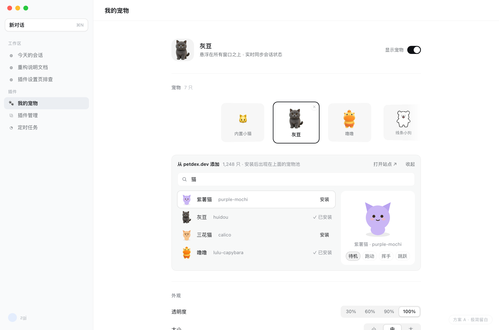
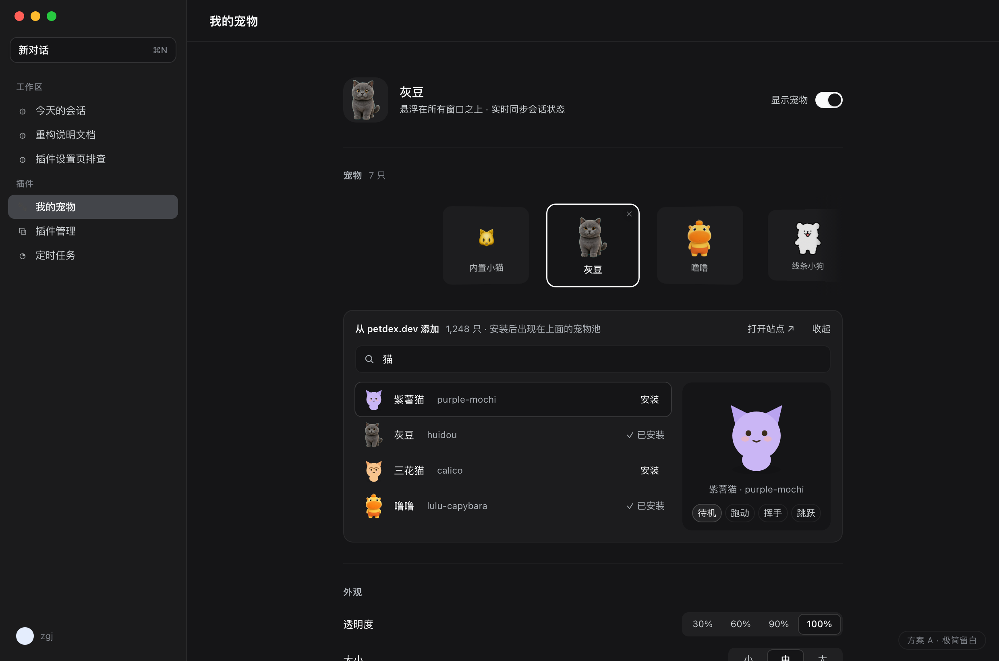

### 4.2 关键规格

| 项 | 值 |
|---|---|
| 内容宽 | 620px 居中（`padding: 44px 0 72px`） |
| 区块间距 | `26px` 上下 + `1px` 顶边线 |
| 宠物切换 | 3D 轮播：116×104 卡（图 48px，`radius 12`）+ 11.5px 名称；16°/28px；当前卡居中、1.5px 内描边；右侧 34px 渐隐 |
| 添加行 | 36px 高、虚线 `border-l2`、`radius 8`，右侧"1,248 只可选" |
| 设置行 | 30px 高，label 12.5px 左、分段控件右 |
| 分段控件 | 24px 内块、`radius 6`、轨道 `label-primary 5%` |
| 状态行 | 6px 圆点 + 12.5px「就绪」+ 11.5px 版本 + 右侧 11.5px 文字按钮 |
| 容器卡片 | **0**（轮播卡不计） |
| 首屏 | 1440×900 无需滚动即可看到全部区块（身份条 + 宠物 / 外观 / 运行环境） |

### 4.3 取舍

- ✅ 最"静"、最贴 DSH 原生设置页气质；改动面最小；表格化信息为主。
- ⚠️ 信息密度低（但对"设置页"这不是缺点）；安装默认折叠，多一步点击；宠物数量只影响横向滚动长度，不影响布局，但超过 ~15 只时建议加搜索/分组。

---

## 5. 方案 B：分栏设置

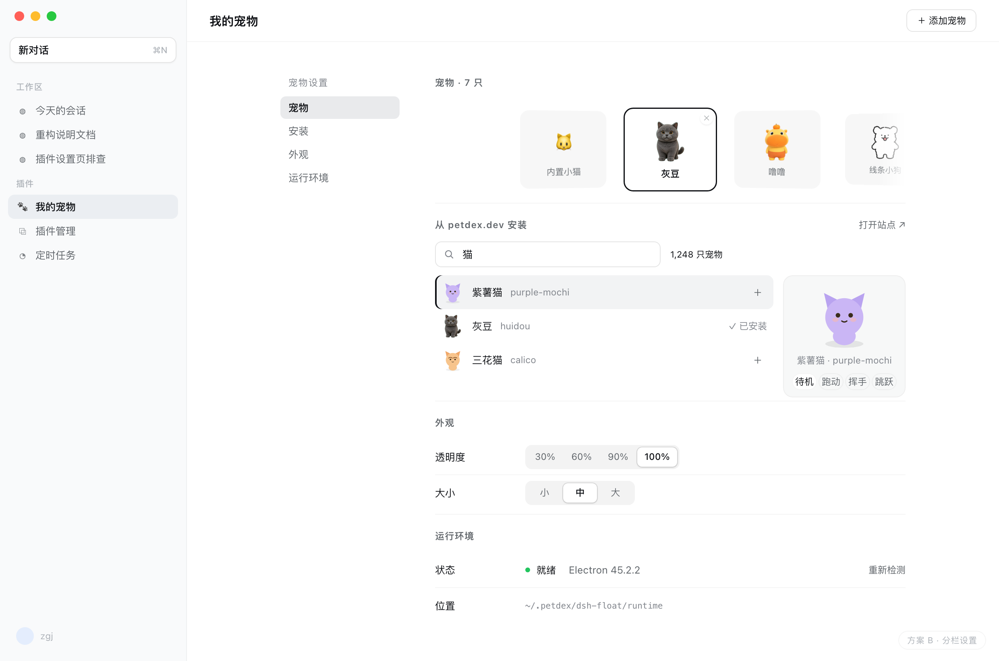
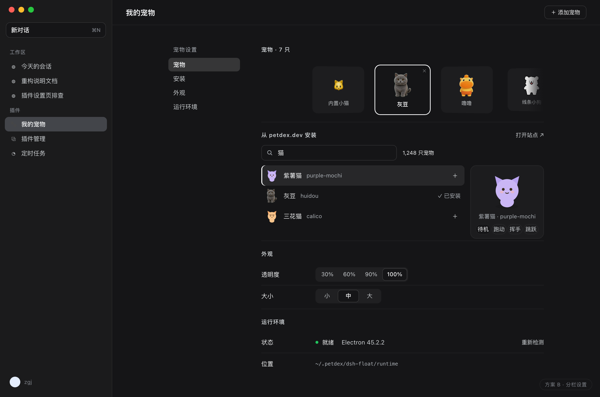

### 5.1 手法

1. **页内左目录**（148px）：宠物 / 安装 / 外观 / 运行环境，锚点滚动 + 高亮；相当于给这 4 个分组加了一张"地图"。
2. **一切变成"设置行"**：44px 行高、label 左、控件右、行间 1px 细线，没有卡片。
3. **分组标题降为标签**：11.5px/600 / 次要色 / `letter-spacing`，负责分组但不抢视线。
4. **宠物条保留 3D 切换**（同一套 16°/28px 参数），卡片压到 2 行；安装是"搜索 + 结果行 + 右侧预览卡"。
5. 顶部右侧固定「＋ 添加宠物」，任何时候都能进安装。

### 5.2 关键规格

| 项 | 值 |
|---|---|
| 内容宽 | 776px（目录 148 + 间距 44 + 内容 584） |
| 行高 | 44px，行间 `1px` 细线（`last-child` 去掉） |
| 分组标题 | 11.5px/600 次要色 |
| 宠物切换 | 与 A 相同的 3D 轮播（116×104 卡、16°/28px），嵌在 584px 内容列里 |
| 预览卡 | 152px 宽、`radius 12`、`label-primary 3%` 轻着色、动作胶囊 11.5px |
| 容器卡片 | **0**（轮播卡不计） |
| 首屏 | 4 个分组全部可见（1 屏） |

### 5.3 取舍

- ✅ 信息密度最高、扩展性最好（再加 3 个分组也不乱）；最像"专业工具"。
- ⚠️ 结构改动最大（新目录组件 + 滚动监听）；窄窗口（< 720px）需要把目录折叠成横向 tab；"分栏 + 细线"偏冷，少了宠物插件该有的可爱感。

---

## 6. 方案 C：舞台聚焦

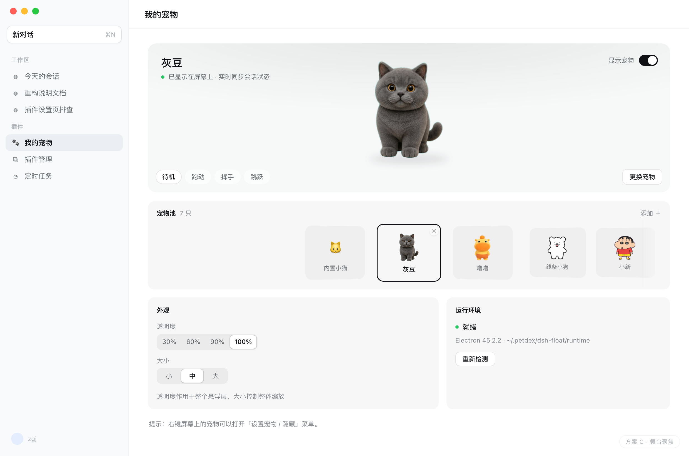
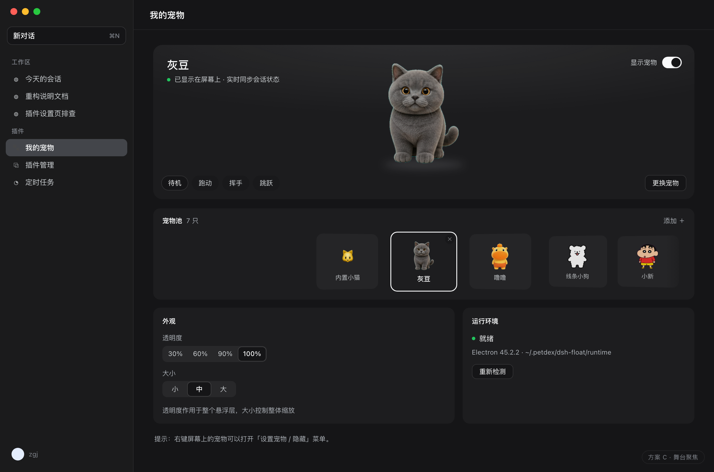

### 6.1 手法

1. **舞台做主角**：320px 高、`radius 16`、顶部径向渐变 + 柔和地面阴影，宠物站中间（196px）；左上角是名字（19px）与状态点，右上角是开关，底部是动作胶囊与「＋ 添加宠物」（唯一安装入口）。
2. **舞台下方是整行 3D 切换条**（940px 宽，当前卡居中，右侧渐隐），再下方两张**等宽**轻卡片：外观（两行「label + 分段」）、运行环境（状态行 + 路径行）——用 `label-primary 3.5%` 轻着色而不是描边。
3. **安装改成右侧抽屉**：不打断当前页；抽屉里是搜索 + 结果 + 预览 + "打开站点"。带遮罩、焦点陷阱、Esc 关闭（可复用现有 `useModalA11y`）。

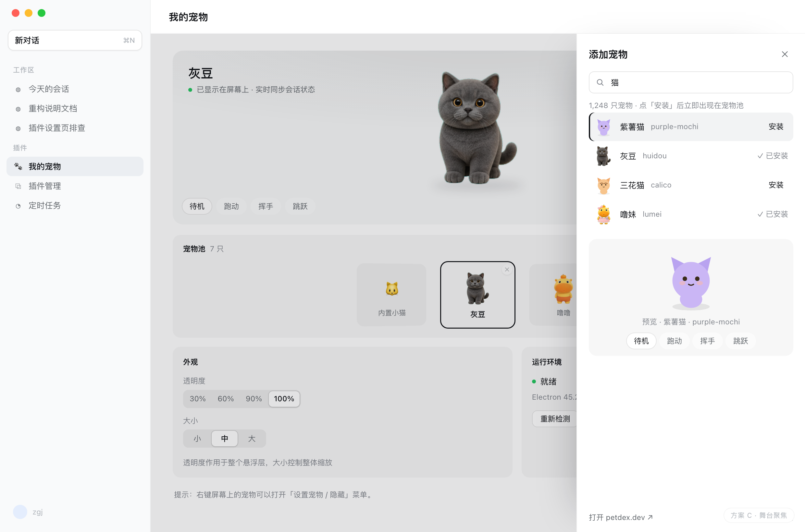
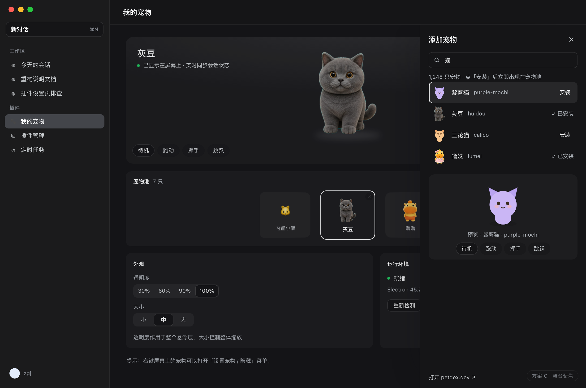

### 6.2 关键规格

| 项 | 值 |
|---|---|
| 内容宽 | 940px 居中（`padding: 26px 0 48px`） |
| 舞台 | 320px 高、`radius 16`、名字 19px/600、动作胶囊 26px 高（C2 定稿值） |
| 卡片 | 2 列（1 / 1），`radius 12`、`padding 16/18`、`min-height 132` |
| 切换条 | 整行 3D 轮播（116×104 卡、16°/28px），嵌在 3.5% 轻着色面板里 |
| 抽屉 | 352px 宽、左侧 `1px` 线 + 阴影、内边距 18px |
| 容器卡片 | 3（切换条面板 + 2 张卡） |
| 首屏 | 舞台 + 切换条 + 2 张卡全部可见（内容高约 735px，1440×900 无滚动） |

### 6.3 取舍

- ✅ 最有"宠物产品"的性格，首屏就是主角；安装不再挤在页面里；适合后续加"动作/交互/气泡样式"等扩展。
- ⚠️ 实现最重（抽屉 + 焦点管理 + 舞台动效）；大舞台对"设置页"是奢侈的；宠物再多也只是切换条更长，页面高度不变。

---

### 6.4 C2：选定 C 之后的收敛（落地版）

在 C 上只做减法和对齐，不改方向：

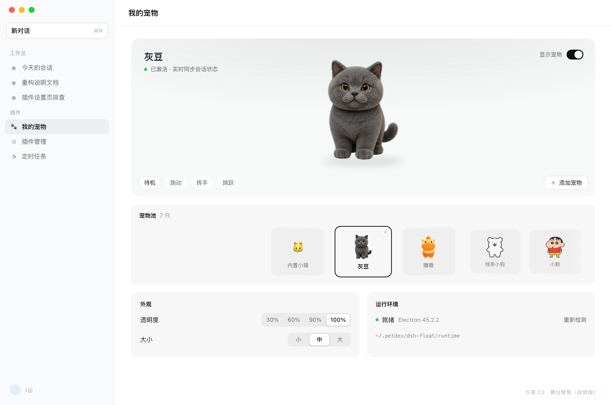
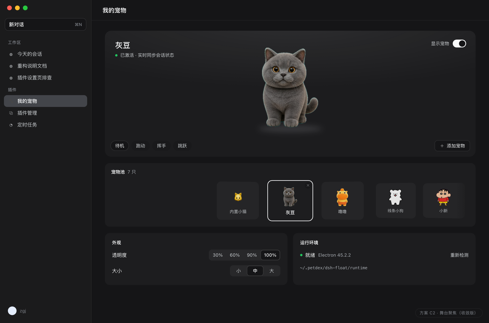

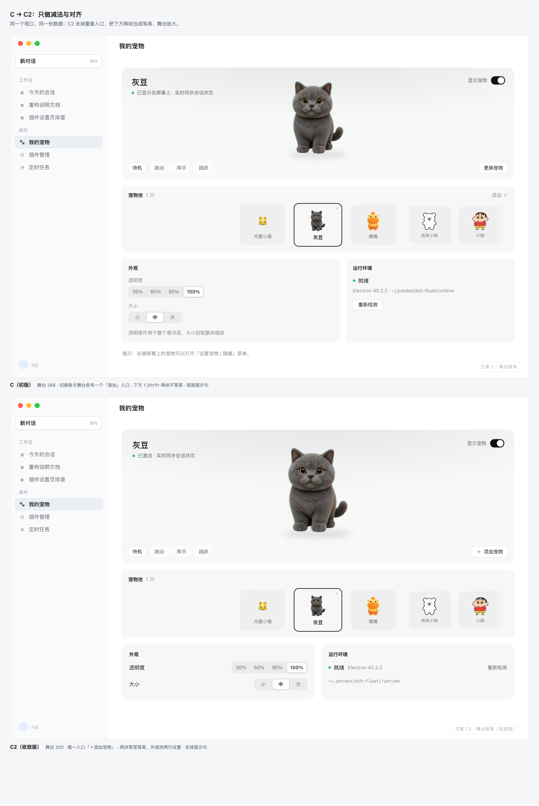

| # | C | C2 | 为什么 |
|---|---|---|---|
| 1 | 舞台 268px、宠物 168px | **320px、196px** | 舞台是主角，撑满首屏更像"舞台" |
| 2 | 舞台「更换宠物」+ 切换条「添加 ＋」 | **只在舞台底部留一个「＋ 添加宠物」** | 同一个入口出现两次，删掉切换条那个 |
| 3 | 切换条头部带「添加 ＋」 | **只留「宠物池 · 7 只」** | 头部回到"纯标签"，不抢主操作 |
| 4 | 下方 1.3fr / 1fr 两块不等宽，外观 label 在上 | **1fr / 1fr，外观改成两行「label + 分段」** | 等高、右缘对齐、控件成行 |
| 5 | 外观卡带一句说明（14px 高） | **去掉**，说明只留在文档/悬浮 | 设置页不需要逐项解释 |
| 6 | 运行环境：状态行 + 版本·路径行 + 按钮行 | **一行「状态 + 版本 + 重新检测」+ 一行路径** | 少一行，信息不变 |
| 7 | 页脚提示「右键宠物可打开菜单」 | **移除** | 与设置无关，应放进首次使用引导 |
| 8 | 切换条头部与舞台按钮各有一个加号 | 统一为 `＋` 14px 图标 + 文字 | 图标语言一致 |

> 落地时就按 C2 这一版做（等价于 §6.2 规格 + 上表 8 条）：
> 舞台 320 / 切换条 940 整行（3D 16°/28px）/ 两块等宽卡片 132px 高 / 抽屉 352px。


---

### 6.5 C3：宠物池并入舞台（融合版，当前推荐）

把切换条从"舞台下面的另一个面板"挪进舞台内部，页面从三层表面收成两层：

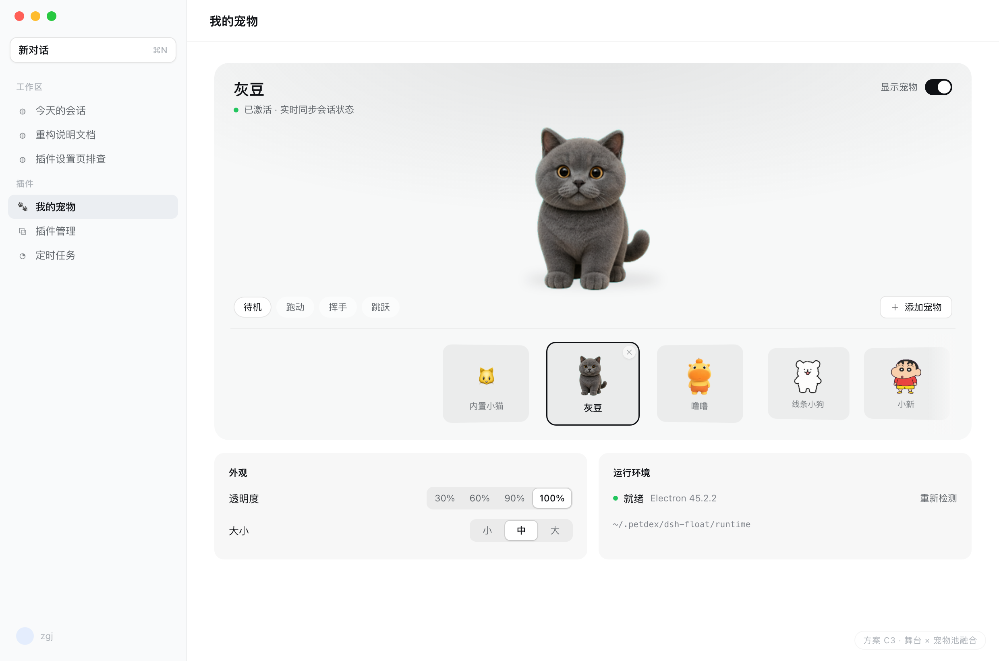
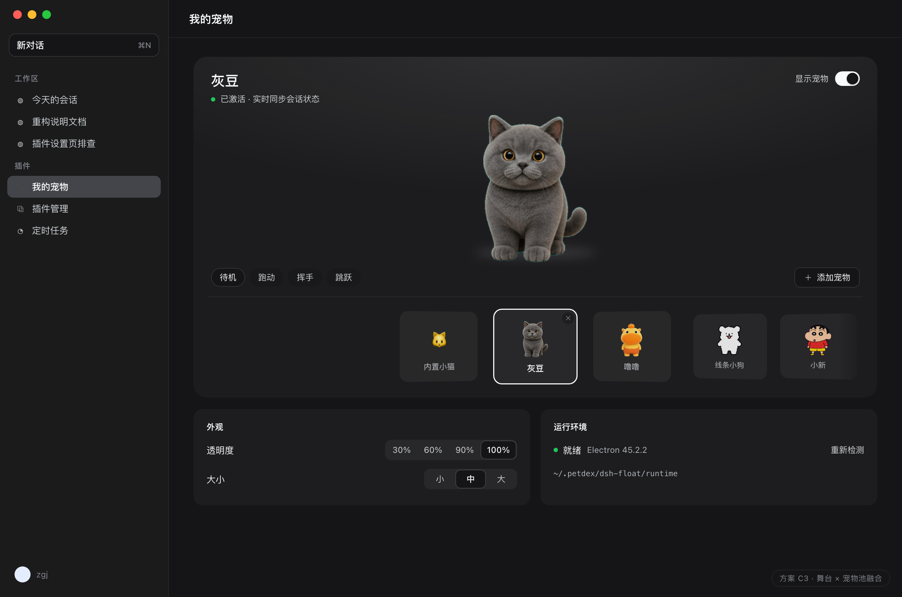

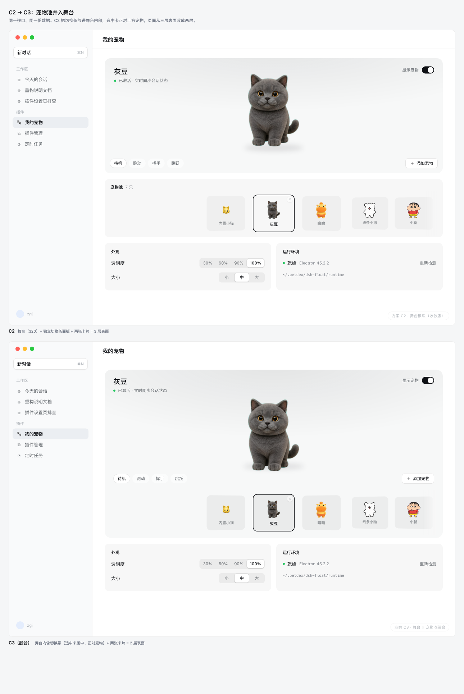

**结构**（一个表面，四段）：

```
.stage
├─ .stage-head   名字 + 状态行        ……        开关
├─ .petbox       大宠物（196px）+ 地面阴影
├─ .bar          动作胶囊              ……      ＋添加宠物
└─ .dock         1px 分隔线 + 3D 切换带（选中卡正对上方宠物）
```

| 项 | 值 |
|---|---|
| 舞台 | 不写死高度（内容撑开约 470px），`padding: 20px 20px 8px`、`radius 18` |
| 分区 | head / petbox(216) / bar(30) / dock，靠间距分隔，只有 dock 顶部一条 `border-l1` |
| 切换带 | 卡片 116×104、舞台内填色提到 5.5%（比舞台底色深一档），选中 1.5px 内描边 |
| 渐隐 | `--dp-fade-bg` 指向舞台底色 `color-mix(label-primary 3%, bg-base)`，右缘不出现"补丁" |
| 表面数量 | **2 层**（舞台 + 外观/运行环境两张卡），比 C2 少一层 |

**为什么这样更"融合"**：

1. 切换带的选中卡**正对上方的大宠物**（都居中在 940 的中线上），视线不用横向跳。
2. 宠物池不再有自己的标题与面板——它变成舞台的"演员席"，和动作胶囊、开关同属一个表面。
3. "＋ 添加宠物"仍在舞台底部右侧，安装入口只有一个；安装仍走右侧抽屉。

**落地注意**：

- 舞台不要写死高度：`display: block` + 内部四段顺序排版，宠物区固定 216px 即可自适应内容。
- `.dock` 的负边距不要用（保持内容宽度），分隔线只在 dock 顶部；渐隐色跟随舞台底色，避免出现色块。
- 切换带与卡片共用同一套 3D 参数（16°/28px/磁吸），只是容器宽度从 940 整页变成舞台内部宽度。


---

### 6.6 C4：舞台即 3D 切换（不是上下拼接）

C3 仍然是"舞台 + 底部切换带"两个区块，切换带被塞进了舞台，但本质还是**上下拼接**。
C4 换掉这个结构：**舞台本身就是一个 3D 场景**，宠物们站在同一地面上，选中的那只在中央放大，两侧按透视后退。

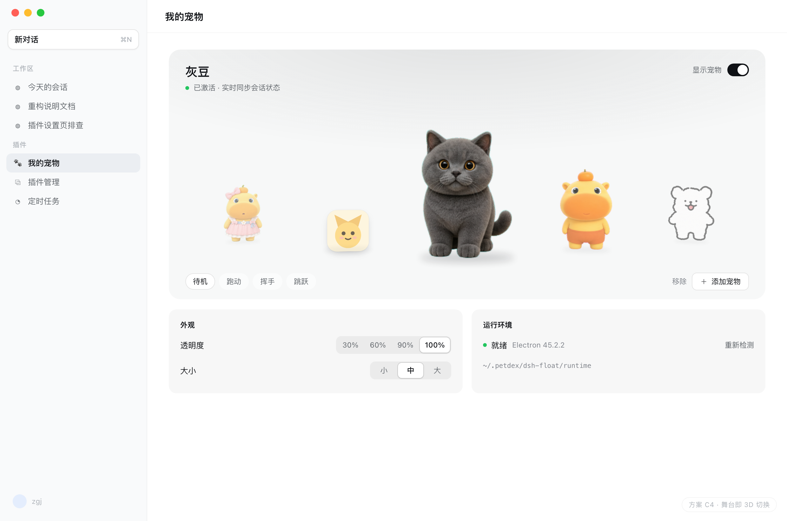
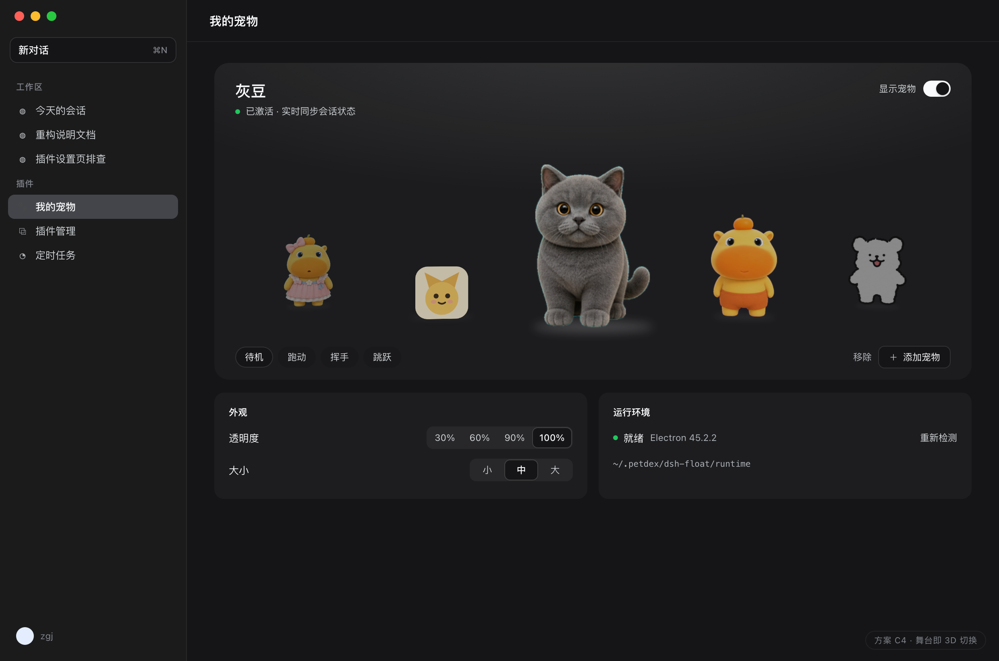

拖动过程中的中间态（两只各偏半格，正在互换位置）：

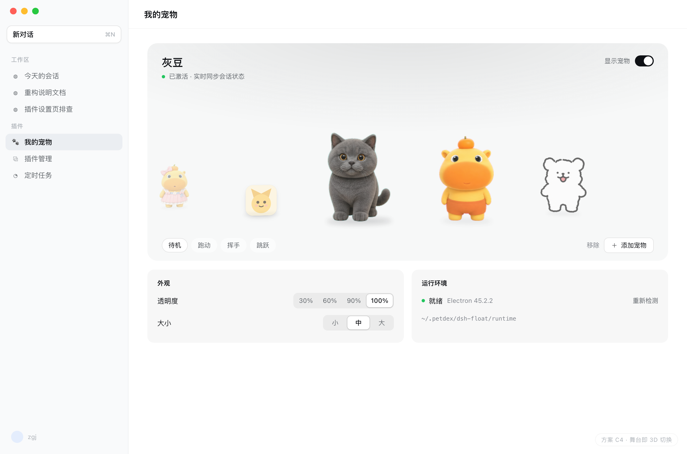

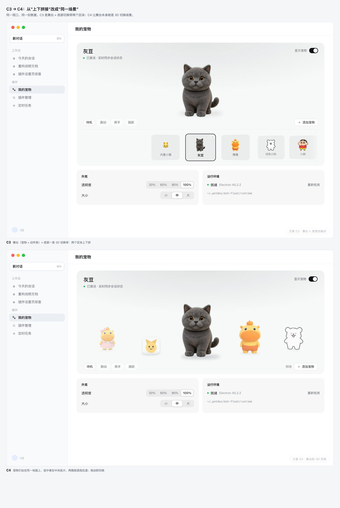

**结构**（一个场景，没有第二个"切换条"区块）：

```
.stage
├─ .stage-head   名字 + 状态行       ……       开关
├─ .scene        3D 场景：.pet-item × N（每只宠物按偏移量定位）
└─ .bar          动作胶囊          ……     移除 · ＋添加宠物
```

**3D 参数**（与 3.7 同一套"克制"原则，只是换成"场景"模型）：

| 参数 | 值 | 说明 |
|---|---|---|
| 水平间距 `step` | 200px | 每格之间的水平距离 |
| 旋转 `rotate` | 12°/格 | 侧边宠物朝外转，避免正对镜头 |
| 纵深 `depth` | 80px/格 | 后退到 Z 轴，配合透视 |
| 抬升 `lift` | 8px/格 | 地面透视：越远越靠上 |
| 缩放 | `1 / (1 + 0.5·|k|)` | 中央 1.0，两侧 0.67 / 0.5 / … |
| 透明度 | `1 − 0.26·|k|`，下限 0.12 | 远处宠物逐渐退场 |
| 隐藏 | `|k| > 2.45` | 避免边缘残影 |
| 环绕 | 索引差取模到 `[-⌊n/2⌋, ⌊n/2⌋)` | 列表首尾相接，**两侧永远有邻居** |

**交互**（模型从"滚动容器"换成"一个偏移量"，比现在更简单）：

- `offset` 是一个浮点数（单位=格）；拖动改变它，`layout()` 就重算每只宠物的 transform。
- 松手 `offset = Math.round(offset)` 吸附；点任意一只宠物走最短路径转到中央；`←/→` 一格一档；滚轮 0.25 格/次，停手吸附。
- 没有滚动容器、没有惯性、没有 scroll-snap 冲突——现有 `pet-carousel.js` 的拖拽/惯性/滚轮那 90 行可以整体删掉。
- 中央宠物的名字、开关、动作按钮仍然是舞台头部/底部那套，不随切换移动。

**和 C3 的差别**：

| | C3 | C4 |
|---|---|---|
| 结构 | 舞台 + 底部切换带（两个区块） | 舞台即场景（一个区块） |
| 切换控件 | 卡片缩略图（有卡片盒子） | 宠物本体站在舞台上（无卡片盒子） |
| 选中卡与宠物 | 上下两处，视觉上"对应" | 同一只，切换即换主角 |
| 移除按钮 | 选中卡右上角 | 舞台底部工具栏「移除」 |
| 列表边界 | 有首尾，两端会空 | 首尾相接，两侧永远有邻居 |

**落地注意**：

- 内置小猫没有精灵图，用 104px 圆角图标块代替（其余宠物直接用 spritesheet 首帧）。
- 场景容器 `perspective: 1200px`、`transform-style: preserve-3d`；每只宠物 `transform-origin: 50% 100%`，缩放/旋转都以脚底为原点，不会离地。
- 切换时中央宠物的名字要跟着变（React 里由 `activeSlug` 派生，不需要额外状态）。
- 无障碍：场景 `role="group"`，每只宠物 `role="button"` + `aria-label`，只有中央那只 `tabindex=0`；`←/→` 切换并移动焦点。
- `prefers-reduced-motion` 时把 0.34s 的过渡降到 0。


---

### 6.7 C5：保留原 3D 卡片带，选中即舞台（当前推荐）

按"保持原本 3D、只把选中那只变成舞台"来做：**卡片带还是原来的卡片带**（126×118、缩略图 + 名称 + 状态、透视倾斜），中央留出一个舞台位，卡片从舞台两侧滑过；停稳后舞台换成当前宠物。

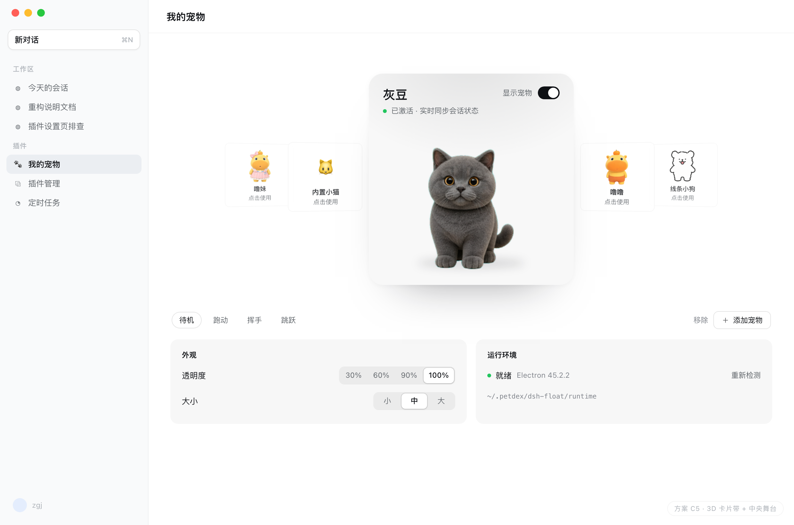
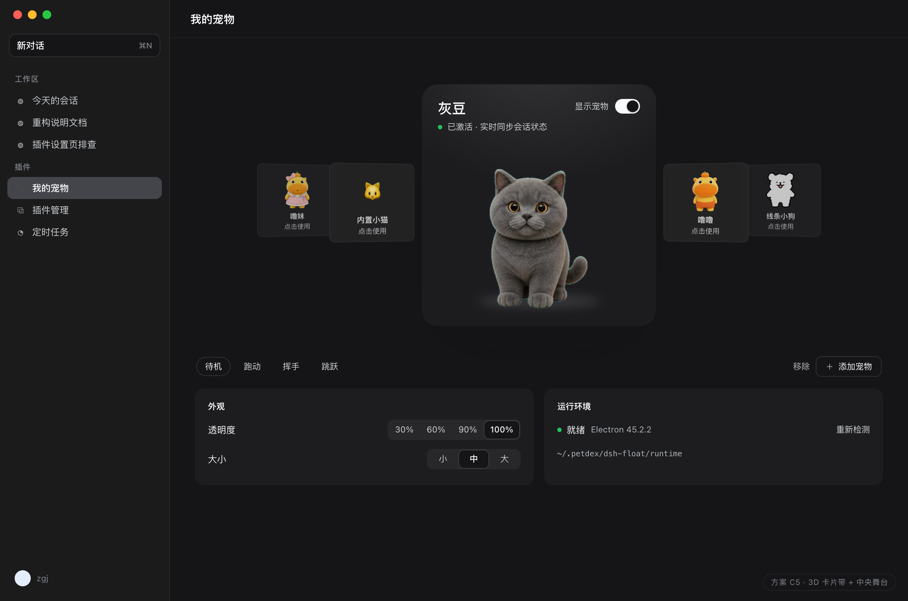

拖动中间态（卡片正从舞台后方滑出）：

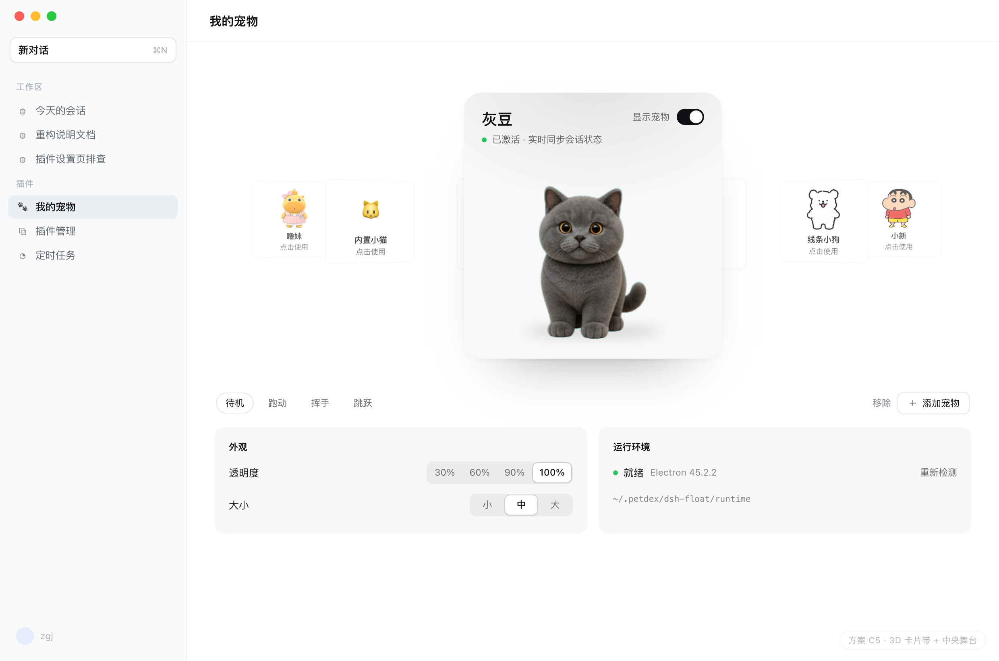

**结构**：

```
.hero
├─ .strip   原本的 3D 卡片带（7 张卡，绝对定位 + 透视）
└─ .stage   中央舞台（320×330）：名字 / 状态 / 开关 / 大宠物 / 地面阴影
```

| 参数 | 值 | 说明 |
|---|---|---|
| 卡片 | 126×118，缩略图 58px，名称 11.5，状态 10.5 | 与改动前的卡片一致 |
| 舞台 | 320×330，`radius 22`，不透明着色 + 径向渐变 | 盖住中央那张卡 |
| 首张邻卡距离 | 250px | 舞台半宽 160 + 间距 27 + 半卡宽 63 |
| 后续间距 | 146px | 卡宽 126 + gap 20（与原版一致） |
| 旋转 / 纵深 | 18° / 110px 每格 | 保留原本的 3D 味道 |
| 透明度 | `1 − 0.12·|k|`，`|k|>2.6` 隐藏 | 远处卡片退场 |
| 中央卡 | 藏在舞台后面（舞台不透明） | 拖出时自然从舞台边缘出现 |

**交互**：

- 拖动 / 滚轮 / `←→` 改变偏移量，松手吸附到最近一张；
- 停稳后舞台交叉换成该宠物（名字、状态、大图）；
- 点侧边卡片 → 转到中央；
- 舞台 `pointer-events: none`，只有开关可点，拖动落在整块 hero 上，手感一致；
- 首帧禁用过渡（`no-anim`），避免进页面时卡片从中心"炸开"。

**为什么这样比 C3/C4 更贴需求**：

| | C4 | C5 |
|---|---|---|
| 3D 形态 | 宠物本体站在场景里（换了模型） | **原卡片带的 3D 样式不动** |
| 选中的表现 | 整条场景的中心宠物放大 | **中央座位直接是舞台** |
| 卡片样式 | 无卡片（宠物本体） | 126×118 原卡片（缩略图 + 名称 + 状态） |
| 视觉重心 | 场景 | 舞台 |


---

### 6.8 C6：舞台保持原样，宠物显示区做成 3D（当前推荐）

**舞台不动**：还是 C2 的结构——左上名字 + 状态行、右上开关、底部动作胶囊与「＋ 添加宠物」、同一套渐变与圆角。
**两处按最新要求调整**：移除改为**悬浮宠物右上角出现 ×**（工具栏不再放「移除」）；下方「设置」与「运行环境」**上下两行**各占满宽（原「外观」改名「设置」，透明度/大小各占一行）。
**只换中间的宠物显示区**：选中的宠物居中放大，两侧宠物按透视后退，拖动/滚轮/←→ 切换，松手吸附。

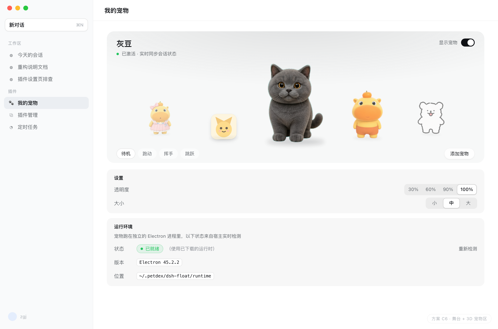

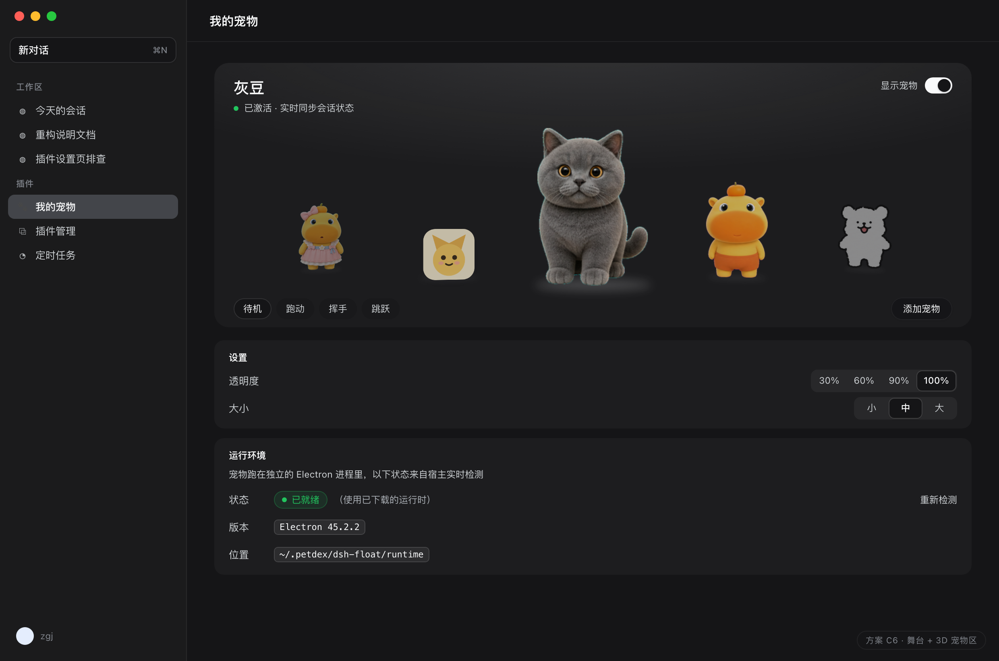

**结构**（和 C2 的舞台一一对应）：

```
.stage
├─ .stage-head   灰豆 + 状态行          开关
├─ .scene        3D 宠物显示区（选中居中，两侧后退）
└─ .bar          待机/跑动/挥手/跳跃    移除 · ＋添加宠物
```

| 项 | 值 |
|---|---|
| 舞台 | 360px 高、`padding 20 22 12`、`radius 18`、渐变与 C2 相同 |
| 显示区 | 236px 高，宠物 190px（居中那只），地面阴影 |
| 3D 参数 | 步距 190px、旋转 14°、纵深 70px、抬升 6px、缩放 `1/(1+0.55·|k|)` |
| 环绕 | 索引差取模，首尾相接，两侧永远有邻居 |
| 动作条 | 左侧动作胶囊、右侧「＋ 添加宠物」；**不再有「移除」** |
| 移除 | 悬浮宠物时右上角出现 ×，**点击直接移除，不做二次确认**；`hover: none` 的触屏上当前宠物常显 0.6 |
| 下方区块 | 「设置」与「运行环境」纵向堆叠、各占满宽；设置卡内两组各占一行（label 左、分段右） |

**运行环境沿用现有文案**（只换样式，不改信息）：

- 标题「运行环境」+ 说明句「宠物跑在独立的 Electron 进程里，以下状态来自宿主实时检测」；
- 三行「状态 / 版本 / 位置」：状态是绿色胶囊「已就绪」+「（使用已下载的运行时）」，右侧「重新检测」；版本 `Electron x.y.z`；位置是等宽路径；
- 其余状态文案（检测中 / 安装中 / 未就绪 / 安装失败 / 检测中… / 已更新）继续用 `locale/zh.js` 里现成的 key，不新造文案。

**和 C4 / C5 的差别**：

| | C4 | C5 | **C6** |
|---|---|---|---|
| 舞台 | 变成一个"场景"，变高 | 降级成卡片带里的一个卡片 | **保持 C2 原样** |
| 3D 位置 | 铺满整个舞台 | 卡片带在舞台两侧 | **只在宠物显示区内** |
| 卡片 | 无（宠物本体） | 有（126×118） | 无（宠物本体站在显示区） |
| 选中表现 | 中央放大 | 中央卡片被舞台盖住 | **中央放大，就是舞台主角** |

**落地映射**（保持测试钩子）：

- 真实组件里把 `.pet-item` 命名为 **`.dpp-pet`**，保留 `.active`（选中）与 `.x`（移除）两个类，`test/web/pet-features.test.ts` 里的 `querySelector('.dpp-pet.active')` / `'.x'` 不用改。
- `pet-carousel.js` 换成"一个 offset 的 3D 模型"（同 §6.6 的 `rel()` + `layout()`），滚动容器、惯性、`scroll-snap` 都可以删掉。
- `pet-page-cards.js` 的 `PetHero` 保持舞台结构，只把 `petbox` 换成 `.scene`。
- `styles.js` 的舞台段基本不变，新增 `.scene` / `.dpp-pet`（3D 定位）即可，其余样式继续复用。


---


> 入口按钮样式：**纯文字胶囊（999）+ 88% 底色的浅色面 + 1px `border-l1` + 极轻投影**，不带图标；和动作胶囊同一套圆角语言；hover 时底色变实、投影加深。比原来的 8px 方角描边按钮更"浮"一点，也更像按钮而不是表单控件。

### 6.9 添加交互（C6 配套）

**入口只有一个**：舞台底部右侧「＋ 添加宠物」（常驻）。安装走右侧抽屉，不打断舞台。

#### 抽屉里的状态机

| 状态 | 界面 | 说明 |
|---|---|---|
| 打开 | 352px 抽屉 + 12% 遮罩，搜索框自动聚焦 | 舞台保持不动，只是变暗 |
| 搜索中 | 结果区显示加载行；输入 200ms 防抖 | 结果来自已缓存的 manifest，秒开 |
| 有结果 | 行：缩略图 + 名称 + slug + 「安装」/「✓ 已安装」 | 选中行浅色底 + 名称加粗（**无竖线**） |
| 预览 | 右侧 152px 预览卡：大图 + 四个动作胶囊 | 点动作试看，不安装也能看 |
| 安装中 | **进度条集成在该行底部**（2px），右侧按钮位显示百分比；同时间只允许一个安装 | 不打断列表，进度与那条数据一一对应 |
| 完成 | 该行按钮变成「已安装」；抽屉关闭 → 新宠物插入 3D 行（当前宠物右侧）→ 自动选中并切舞台 → 底部 toast | 不做成功面板/toast 之外的花活 |
| 失败 | 行内红字「安装失败，重试」+ 「重试」链接 | 抽屉不关，可继续挑 |
| 空结果 | 「没有匹配的宠物」+ 「打开 petdex.dev ↗」 | — |

#### 完成的交接（关键）

1. 新宠物插到当前宠物的**右侧一格**，`offset + 1`，3D 行平滑滑过去；
2. 舞台名字、状态、大图同步切换；
3. 底部 toast：`✓ 已添加「紫薯猫」到宠物池`（`role="status"`，2s 自动消失）；
4. 焦点回到「＋ 添加宠物」，方便连续添加。

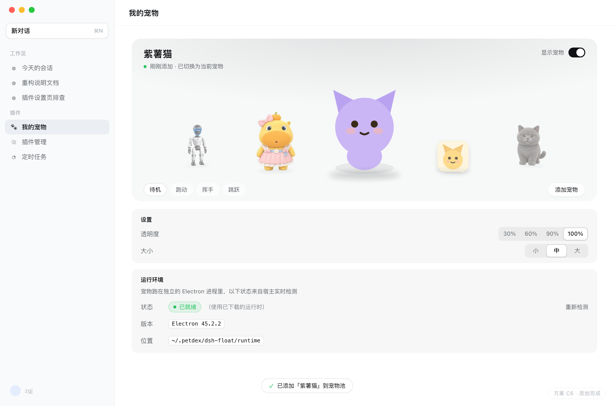

#### 布局（结果多时不能把预览挤走）

- 抽屉是 `flex` 纵向布局，**抽屉本身不滚**（`overflow: hidden`）；
- 头部 / 搜索 / 数量提示固定；**结果区 `flex: 1; min-height: 0; overflow-y: auto`**，自己滚；
- **预览卡固定在结果区下方**（`flex: none` + 顶部细线），不随结果数量下移；
- 底部「打开 petdex.dev」固定在最下；
- 结果再多，画面上始终是「头 + 搜索 + 滚动结果 + 预览 + 底栏」，预览不会被挤出去。

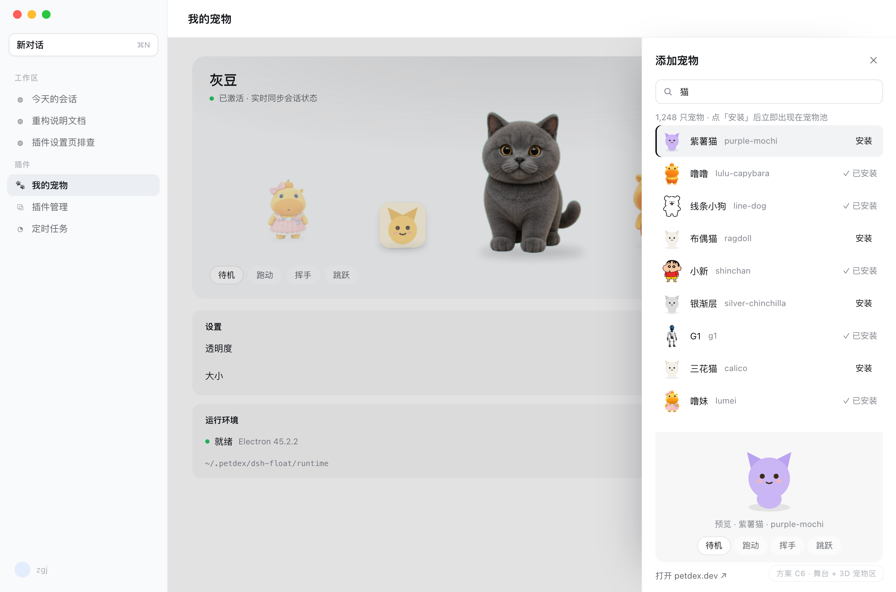

#### 交互细节

- **关闭**：`Esc` / 点遮罩 / 右上 ×；关闭后焦点回到「＋ 添加宠物」。
- **键盘**：搜索结果 `↑↓` 移动、`Enter` 安装、`Tab` 循环在抽屉内（复用 `useModalA11y`）。
- **防重复**：安装中「＋ 添加宠物」与结果行的「安装」都置灰。
- **空态与失败**：都在抽屉内就地展示，不弹系统对话框。
- **性能**：manifest 已在应用空闲时预热（现有 `fetchManifest` + TTL 缓存），打开抽屉不转圈。

#### 与现有实现的对应

| 设计 | 现有代码 |
|---|---|
| 入口按钮 | `pet-page-cards.js` 的 `InstallCard` 里的搜索区 |
| 抽屉 | `InstallCard` 的结果 + `.dpp-preview` 预览（已有） |
| 安装完成回填 | `install()` → `fetch(/installed)` → `shared.set({ installed })`（已有） |
| 自动选中 | `install()` 里已调用 `setActive(pet.slug)`（已有） |
| toast | 新增：`role="status"` 的小胶囊，2s 自动隐藏 |


---

### 6.10 弹框家族（6 个状态 × 浅/深色）

所有弹框共用一套规则：**圆角 16（对话框）/ 12（面板）**、遮罩 12%、`bg-base` 面 + `border-l2` + 大阴影、主按钮 = 反色、危险 = `state-error`、`Esc`/点遮罩关闭、焦点陷阱（复用 `useModalA11y`）。

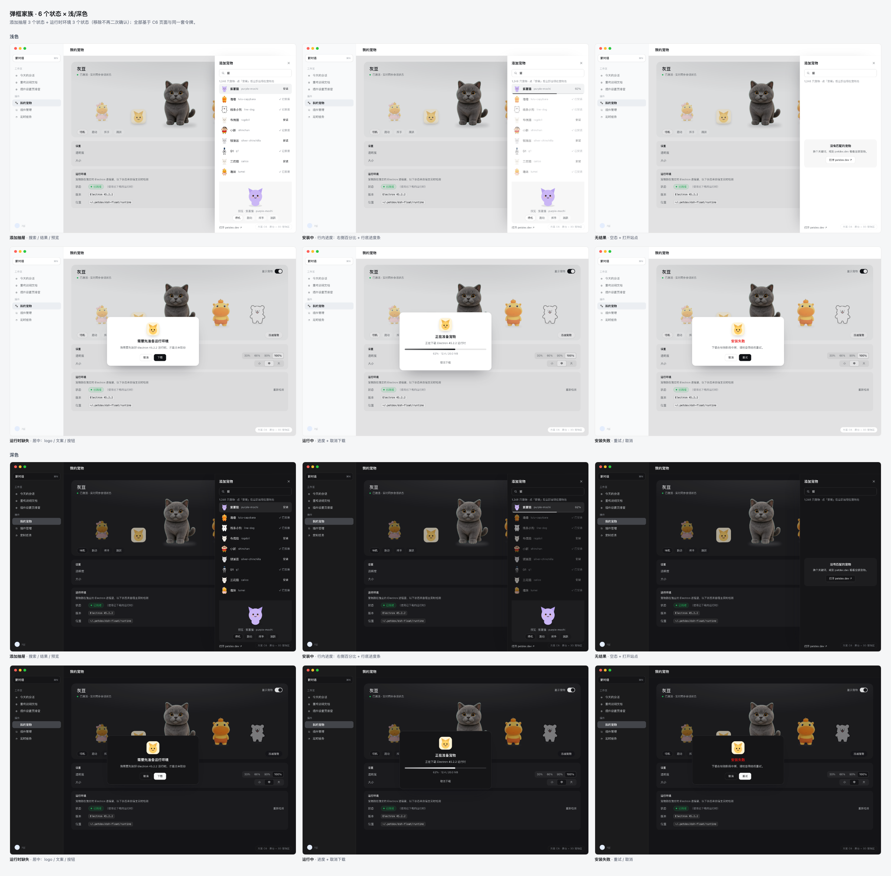

### 1）添加抽屉（352px）

| 状态 | 说明 |
|---|---|
| 搜索 / 结果 / 预览 | 结果区独立滚动，预览钉在底部（§6.9 已修） |
| 安装中 | **进度集成到该数据项**：行底 2px 进度条 + 右侧显示 `62%`；其余行置灰 55% |
| 完成 | 不弹成功页：该行按钮变「已安装」，抽屉关闭，新宠物入列 + 底部 toast |
| 无结果 | 居中空态：没有匹配的宠物 + 打开 petdex.dev |

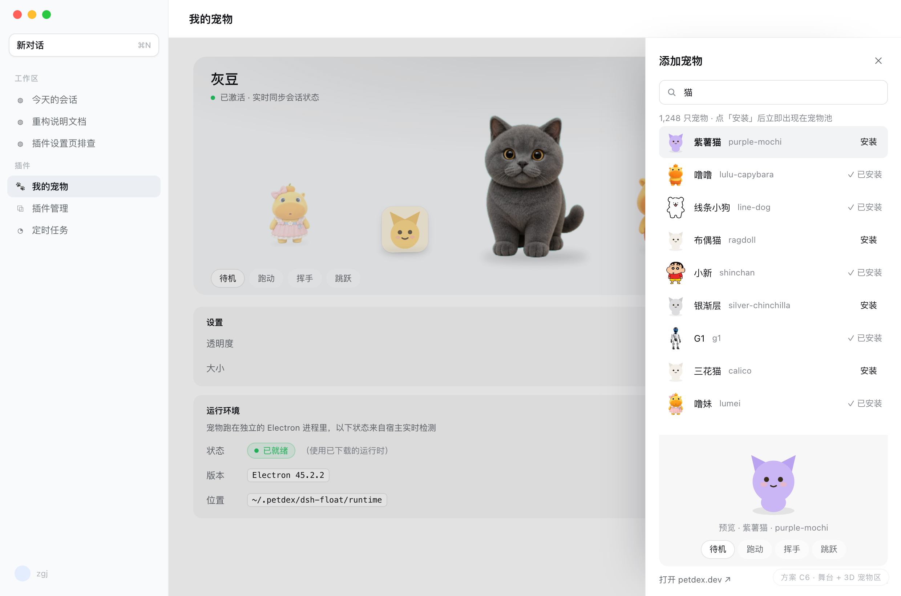
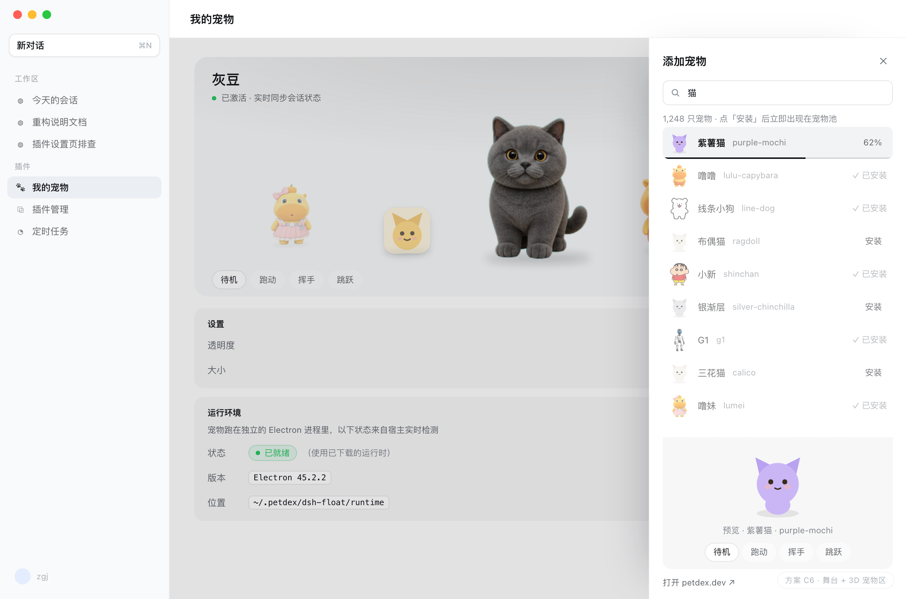
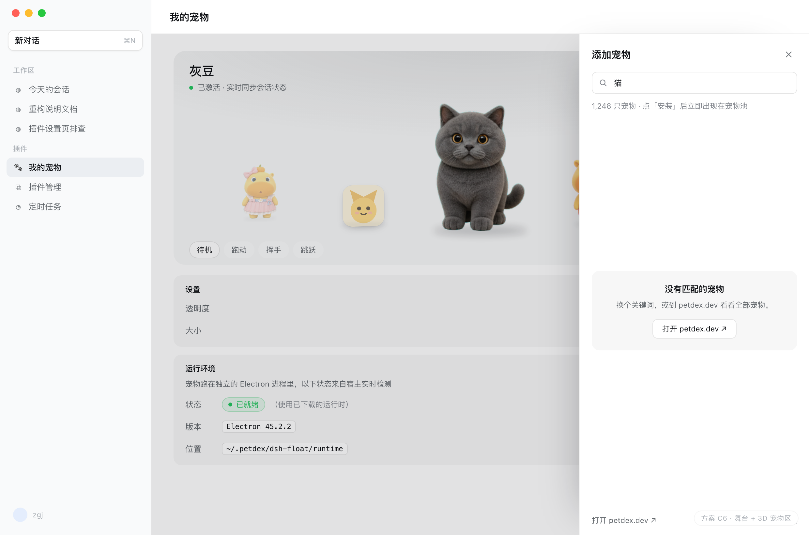

### 2）移除：不做二次确认

- 悬浮宠物右上角的 × 点击即移除；
- 移除后底部 toast 提示「已移除「灰豆」」，不做确认弹框。

### 3）运行时环境（400px，整体居中）

| 状态 | 标题 | 动作 |
|---|---|---|
| 缺失 | 需要先准备运行环境 | 取消 / 下载 |
| 下载中 | 正在准备宠物 | 进度条 + `62% · 12.4 / 20.0 MB`，取消下载 |
| 失败 | 安装失败（红） | 取消 / 重试 |
| 检查中 / 已就绪 | 复用现有文案与逻辑 | — |

> 布局：logo、标题、说明、进度、按钮**全部水平居中**（不是左对齐 + 右对齐按钮）。

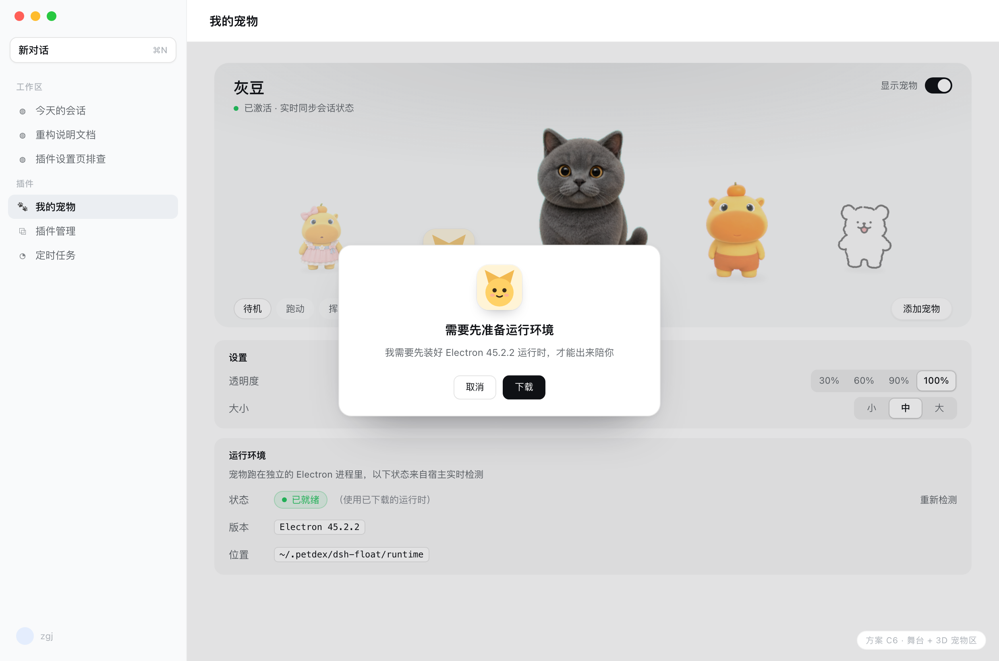
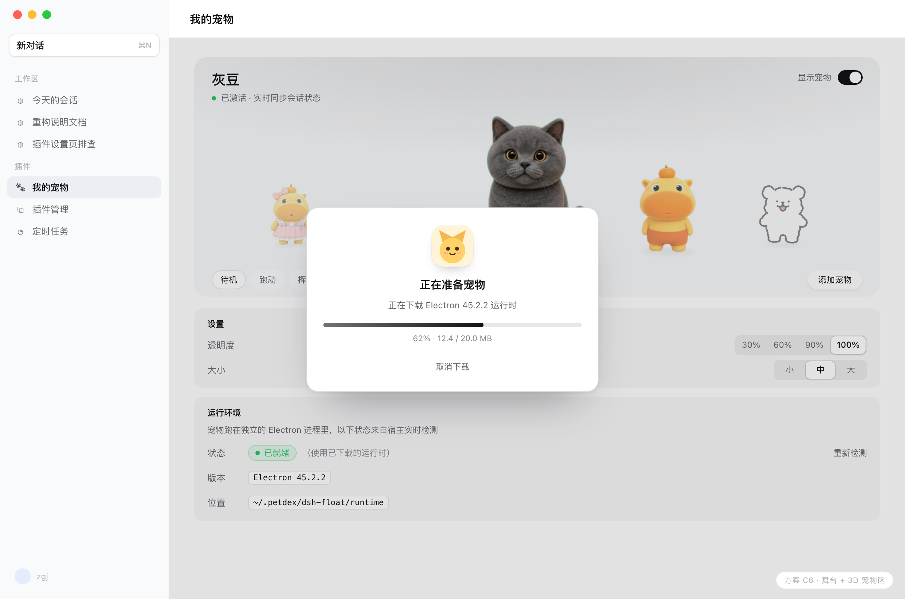


### 4）全局 toast

- `role="status"`，2s 自动消失，底部居中；
- 成功用 `✓`，失败用红色图标 + 文案，不带按钮。

> 全部 12 张（6 状态 × 浅/深）在 `screens/dialogs-*.png`；交互稿 `mockups/dialogs.html`，用 `?d=drawer|drawer-installing|drawer-empty|runtime-missing|runtime-progress|runtime-failed` 切换，`&theme=dark` 看深色。

---

## 7. 对比与推荐

> **决策**：已选定方案 C。收敛过程：C → C2（§6.4）→ C3（§6.5，上下拼接）→ C4（§6.6，舞台即场景）→ C5（§6.7，卡片带 + 舞台）→ **C6**（§6.8，舞台原样 + 宠物显示区 3D）。**C6 + §6.9 的添加交互是当前推荐落地版。**

| 维度 | 现状 | A 极简留白 | B 分栏设置 | C 舞台聚焦 |
|---|---|---|---|---|
| 视觉重量层级 | 弱（5 个等重卡片） | 强（一条轴） | 强（目录 + 分组） | 最强（舞台） |
| 首屏信息完整度 | 4/5 区块（外观只露出标题） | 全部 | 全部 | 全部 |
| 3D 切换 | 22°/38px、3 行小字、惯性 | 保留：16°/28px、2 行、磁吸 | 同 A | 同 A（整行） |
| 正文字号档位 | 10 | 3（+1 等宽） | 3（+1 等宽） | 4 |
| 圆角档位 | 8 | 4（+胶囊） | 3（+胶囊） | 4（+胶囊） |
| 卡片/描边盒数量 | 5 | 0 | 0 | 3（含切换条） |
| 专业感 | 中 | 高 | 最高 | 中高 |
| 可爱/品牌感 | 中 | 低 | 低 | 高 |
| 结构改动量 | — | 小 | 中 | 大 |
| 预计工时 | — | 0.5–1 天 | 1–1.5 天 | 1.5–2 天 |
| 回归风险 | — | 低 | 中（目录/锚点） | 中高（抽屉/焦点） |

**推荐路径：A 作为主线，B 的分组行用在"宠物多"之后，C 的抽屉单独移植。**

理由：
- 这个页面的真实使用频率是"偶尔进来换个宠物/调透明度"，**不应该为低频设置付出一屏滚动的代价**；
- A 的改动集中在 1 个 CSS 文件 + 3 个组件，能在不破坏 `role="switch"`、`.dpp-search input`、`.dpp-pet.active`、`.x`、`.dpp-preview` 这些测试钩子的前提下完成；
- C 的抽屉（安装）与 A 的折叠面板可以二选一，**优先做 A 的就地展开**，等安装流程真的变复杂再升级为抽屉。

---

## 8. 实施路线（建议按此顺序）

### Phase 0 · 规范层（半天，零结构改动）

`src/scene/web/styles.js` 内：

1. 引入 3.6 的 `--dp-*` 令牌。
2. 把 `9.5/10/10.5/11/11.5/12/12.5/13.5/16` 收敛为 `11.5 / 12.5 / 15`（等宽 10.5）。
3. 圆角收敛为 `6 / 8 / 12 / 16 / 999`。
4. `.dpp-card` 去掉 `background` 与 `border`（或改成 `sec` 细线分区），删除 `.dpp-card + .dpp-card` 的 margin 叠加。
5. 修 `.dp-btn--primary` 的暗色对比度（改反色）。
6. 删除 `pet-page.js:192-206` 的三个死样式对象；把 `pet-page-cards.js` 的 10 处内联 `style` 迁成类。
7. 补 `:focus-visible`、`prefers-reduced-motion`、`.dpp-kv code { min-width:0; overflow:hidden; text-overflow:ellipsis }`。

> 预期收益：**不用改任何结构**，页面已经不再是"一叠线框盒子"。

### Phase 1 · 方案 A 结构（半天–1 天）

| 文件 | 改动 |
|---|---|
| `pet-page.js` | 去掉 hero 的重复标题；把 `<InstallCard>` 移入「宠物」区，用 `expanded` 状态控制；runtime 换成页脚组件 |
| `pet-page-cards.js` | `PetHero → PetRow`（身份条）；`InstallCard → AddPetPanel`（收起/展开两态）；`RuntimeCard → RuntimeFooter` |
| `pet-carousel.js` | **保留 3D**：换 3.7 的参数、卡片 2 行、惯性改磁性吸附、补键盘/焦点/`pointercancel`，修 `classList.onRemove`；`active/remove/切换` 行为与 `.dpp-pet` 类名不变 |
| `styles.js` | 用第 4 节规格重写页面段（约 120 行 CSS） |

### Phase 2 · 可选增强

- 宠物数 > 15 时，给切换条补"搜索 / 分组"入口（否则横向滚动过长）。
- 安装流程需要"分类/排序/详情"时，升级为 C 的右侧抽屉（复用 `modal-a11y`）。

### 每阶段必跑的检查

```bash
npm run build
npx vitest run test/web        # 页面交互（switch / 搜索 / 预览 / 移除）
npm run check:debt             # rgba/hex/重复原语棘轮
npm run lint && npm run typecheck:js
```

注意事项：

- 测试依赖的选择器：`[role="switch"]`、`.dpp-search input`、`.dpp-pet.active`、`.x`、`.dpp-preview`。**重构时保留这些类名/角色**，否则要同步改 `test/web/pet-features.test.ts` 与 `pet-page-interaction.test.ts`。
- `scripts/check-debt.mjs` 目前**不扫描** `src/scene/web/styles.js` 与 `pet-page*.js`（只把 `client.js`、screen、core、host、assets 纳入统计），所以新增 `rgba()` 不会被拦。建议顺手把 `styles.js` 纳入扫描，避免这次优化又把颜色字面量加回来。

---

## 9. 验收清单

- [ ] 浅色 / 深色各截一张 1440×900，**首屏无滚动**即可看到"开关 + 宠物池 + 外观"
- [ ] 全文正文字号 ≤ 4 档；圆角 ≤ 5 档（可用 `grep -o "font-size:[^;]*"` 自检）
- [ ] 所有 `border` 只用 `border-l1`（可交互控件除外）
- [ ] 主按钮在深色下可读（对比度 ≥ 4.5:1）
- [ ] 3D 切换：拖动后停在最近一张卡；远端卡旋转 ≤ 26°、无镜像；邻卡名称可读
- [ ] 键盘：Tab 能到每个宠物卡、←/→ 能切换并居中、移除按钮、分段控件；焦点环可见
- [ ] 触摸：移除按钮常显，所有点击目标 ≥ 28×28
- [ ] 长路径截断 + `title` 悬浮全文
- [ ] 关闭动画时（`prefers-reduced-motion`）无布局跳动
- [ ] `npx vitest run test/web` 全绿

---

## 10. 目录说明

```
design/设置页优化/
├─ 优化方案.md             ← 本文
├─ compare.html            ← A / B / C 四版对比页
├─ c-compare.html          ← C vs C2
├─ c23-compare.html        ← C2 vs C3
├─ c34-compare.html        ← C3 vs C4
├─ dialogs-gallery.html    ← 弹框家族总览
├─ render.sh               ← 用本机 Chrome 无头重绘 PNG
├─ mockups/
│  ├─ base.css             ← DSH 令牌 + 外壳
│  ├─ baseline.html        ← 现状复刻
│  ├─ carousel.js          ← 3D 卡片带（滚动模型）
│  ├─ carousel3d.js        ← 3D 环绕场景（offset 模型）
│  ├─ stage5.js            ← 卡片带 + 中央舞台
│  ├─ carousel.html / params.html   ← 轮播原型与参数对比
│  ├─ a.html / b.html               ← 方案 A / B
│  ├─ c.html / c2.html / c3.html    ← 方案 C / C2 / C3
│  ├─ c4.html / c5.html / c6.html   ← C4 / C5 / C6
│  ├─ c6-hover.html / c6-added.html ← C6 的悬浮与完成态
│  └─ dialogs.html                  ← 弹框家族（?d= 切换 8 个状态）
├─ screens/                ← 全部效果图（含 compare / dialogs-gallery）
└─ assets/                 ← 从本机 petdex 精灵图裁出的首帧
```

> 设计稿是**可交互的**：打开 `mockups/carousel.html` 或任意一版，都能拖动 / 滚轮 / ←→ 切换，并松手自动吸附；`?at=0.5` 可停在两张卡之间观察中间态。
>
> 宠物图与名称来自本机 `~/.petdex/pets/*`（真实首帧）；"紫薯猫/三花猫"是用于演示安装态的占位形象；"1,248 只"与 "Electron 45.2.2" 为示意数据。


---

## 13. 悬浮层气泡样式体系

与设置页同一套语言：**实底 + 发丝边 + 柔和投影**，不再使用渐变玻璃、高光圆珠和胶囊外壳。

### 13.1 令牌（`src/scene/screen/style.css` → `:root` 的 `--dpb-*`）

| 令牌 | 亮色 | 暗色 | 用途 |
|---|---|---|---|
| `--dpb-surface` | `#ffffff` | `#1c1c20` | 气泡底 |
| `--dpb-border` | `rgba(16,16,24,.10)` | `rgba(255,255,255,.12)` | 发丝边 |
| `--dpb-text / -2 / -3` | `#121216 / #56595f / #8b8f97` | `#f2f2f4 / #bcbec4 / #8b8f97` | 标题 / 正文 / 辅助 |
| `--dpb-primary` | `#121216` | `#f2f2f4` | 选中项与主按钮 |
| 状态色 | success `#2f9e44`、warn `#e8a33d`、danger `#e5534b`、neutral `#9aa0a8` | 同 | 6px 状态点 |
| 圆角 | `card 14`（状态与动作卡统一）/ `ctl 8` / `pill 999` | 同 | 与页面令牌一致 |
| 阴影 | `0 10px 26px -14px rgba(16,16,24,.32), 0 1px 2px rgba(16,16,24,.06)` | 加深 | 一层接触光 + 一层环境影 |

### 13.2 组成

- **状态点**：6px 实心圆，颜色即状态；仅 working 呼吸，done 常亮；
- **正文**：12.5/1.5，最多两行，`展开全文` 才展开；
- **“打开会话 ›”**：与同行正文同字号同基线（12.5/500），辅助色，悬停加深；
- **动作卡**：整卡一张纸，标题与正文不分块（无底色/分割线），只靠 12.5/600 标题 + 11.5 副标题拉开层级；
- **选项**：胶囊 chip，选中 = `--dpb-primary` 实底反白（与设置页胶囊选中一致），推荐角标为 9px 胶囊；
- **按钮**：主按钮 = 主色实底、8px 圆角；次按钮 = 实底 + 发丝边；高度 26。

### 13.3 变体

| 变体 | 形态 | 场景 |
|---|---|---|
| Status | 14px 圆角单行卡 + 状态点 + 可选链接 | 工作 / 完成 / 待命 |
| Alert | 同上，danger 点 | 失败、需要处理 |
| Greet | 无状态点，可多行 | 初次问候 |
| Action（选项） | 16px 卡：标题带 + chips + 描述 + 页脚 | 选择题 |
| Action（审批） | 16px 卡：标题带 + 摘要 + 页脚 | 权限审批 |

### 13.10 计时状态机（对齐 DSH 会话底部）

参考 `dsh-client-ui-chat` 的 `RunningStatus`：1s 刷新、最小 1 秒、`小时/分/秒` 单位（英文 `h/m/s`）、分钟只在 ≥60s 出现。
文案：`正在工作，用时 1秒 · 会话标题`（完成态 `已完成，用时 1秒 · 会话标题`），计时与 DSH 会话底部同源；进入 working 开始计时，切换会话重置，离开 working 停止。
格式化函数收敛到 `src/core/duration.ts`，计时生命周期收敛到 `src/core/run-clock.ts`：

| 事件 | 时钟行为 |
|---|---|
| 进入 working | 开始计时（idle/done → 从 0；paused → 从已累计处继续） |
| 进入 waiting | 暂停，累计已用时间 |
| 回到 working | 从暂停点继续，不清零 |
| 进入 done | 冻结最终用时，显示「已完成，用时 X」 |
| 回到 idle / 更换会话 | 重置 |

两个模块都有单测（时间格式边界 + 状态机转移）。视觉稿：`screens/bubble-timer-working.png`、`screens/bubble-timer-done.png`。

### 13.9 状态点间距与计时方案

- 状态点与文本间距 8 → 6px（动作卡标题行 8 → 6px）；
- 工作中计时显示（待选定）：A 右侧纯文本 / B 右侧胶囊 / C 次级行「已用时」 / D 跟随状态词；视觉稿 `screens/bubble-timer-options.png`。

### 13.8 会话入口基线

- 「打开会话 ›」与相邻正文**同字号同行高**（12.5/1.5）、顶部对齐，因此基线天然一致；状态气泡与动作卡标题行都适用，不再单独上浮。

### 13.7 文案统一

- 会话入口统一为「打开会话 ›」（英文 `Open session ›`），由 `renderer.js` 的 `jumpLabel()` 单一来源提供；
  状态气泡、警报气泡、动作卡（选项/审批）共用，避免再出现「查看会话 / 打开会话」混用。

### 13.6 细节对齐

- 「展开全文」在动作卡的摘要行内改为 baseline 对齐（去掉 margin-top/顶端对齐），字号与摘要一致（11.5）。

### 13.5 卡内间距

- 摘要行与按钮之间：`foot` 上边距 10 → 6，`body` 底部 12 → 10，顶部 6 → 4；审批卡不再出现一条空白带。

### 13.4 去割裂感

- 动作卡不再分「标题带 / 正文区」两块：去掉标题带底色与分割线，整卡一张纸，只靠 12.5/600 标题 + 11.5 副标题拉开层级；
- 圆角统一 14（状态气泡与动作卡同一轮廓），去掉 16/14 混用；
- 发丝边 10% → 8%，投影更轻，hover 位移 2px → 1px；
- 试过加“对话小尾巴”，实测像贴片反而更割裂，已放弃。

### 13.4 视觉稿

- 场景演示（真实悬浮窗渲染）：`screens/bubble-scenarios.png`，动图 `screens/bubble-scenarios.gif`
- 全量变体（亮色）：`screens/bubbles-light.png`
- 全量变体（暗色）：`screens/bubbles-dark.png`
- 真实悬浮窗（工作态）：`screens/bubble-float-working.png`
- 真实悬浮窗（审批态）：`screens/bubble-float-approval.png`

## 12. 实现状态（已落地）

按 C6 + §6.9 + §6.10 落到 `src/`，原有 Host 协议与交互逻辑一行未改：

| 文件 | 改动 |
|---|---|
| `src/scene/web/styles.js` | 整页重写：舞台 / 3D 显示区 / 设置卡 / 运行环境卡 / 抽屉 / 运行时弹框 / 按钮 |
| `src/scene/web/pet-page.js` | 页面骨架改为「舞台 + 两行卡片 + 抽屉」；数据逻辑（installed/status/config/install/remove/runtime 轮询/petOn 防抖）保持原样 |
| `src/scene/web/pet-page-cards.js` | `Stage` / `SettingsCard` / `RuntimeInfoCard` / `AddPetDrawer` |
| `src/scene/web/pet-carousel.js` | 改为 offset 环绕模型（步距 190 / 旋转 14° / 纵深 70 / 抬升 6），拖拽、滚轮、←→、松手吸附 |
| `src/scene/web/locale/{zh,en}.js` | 新增 `addPet` / `settings` / `pgShowPet` / `pgClose` / `pgEmptyHint`，其余复用既有 key |

**保留的契约**（测试与宿主依赖）：`.dpp-search input`、`.dpp-result`、`.dpp-preview`、`.dpp-pet.active`、`.dpp-pet .x`、`.dpp-seg .s`、`[role=switch]`、`.dpp-card`、`desk-pet-page`。

**与原实现的三处有意差异**：

1. 抽屉里的安装态是**不确定进度条**（Host 的 `/install` 只返回成功/失败，拿不到百分比）；
2. 抽屉常驻 DOM、`hidden` 时不可见，打开才启用焦点陷阱——保留原可访问性与既有测试；
3. 运行时弹框**结构不变**，只换样式（整体居中、主按钮反色、阴影）。

**细节修正（对照设计稿复核后）**：

1. 添加抽屉：结果行按钮 `flex: none + nowrap`，名称/slug 单行截断——「安装」不再被挤换行；
2. 3D 显示区：拖拽只在确认拖动后才 `setPointerCapture`，修复「鼠标点击非选中宠物不切换」；
3. 选中宠物常显移除 ×（0.55），悬浮提到 0.95，其余宠物仍悬浮出现；
4. 选中宠物的画布按 1.08 补偿精灵图内边距，视觉大小回到设计稿；
5. 开关轨道 36×20、关态加深到 22% 并加内描边，不再是「白点浮在浅灰上」。

6. 移除按钮回归老版本样式：**裸 × 字形**（无圆底、无描边），悬浮淡入；选中宠物常显 0.45，未选中时 `pointer-events: none` 防误删；
7. 点击任意宠物都会切换并**自动居中**（新增回归测试：点击后该宠物 `translateX(0)` 且 `opacity: 1`）。

8. **点击切换改为在 `pointerup` 上判定**：不再依赖 `click`（3D 变换 + 指针捕获时 click 目标会被改写），
   按下时记录命中的宠物，抬起时若无拖动就切换；同时保留 `click` 作为键盘/无指针事件的兜底。

9. **命中区与 3D 观感分离**：外层 `.dpp-pet` 只做 2D 平移/缩放（命中盒是平的），
   内层 `.dpp-pet-media` 才带 `rotateY/translateZ` 且 `pointer-events: none`——点击不再经过 3D 透视的命中测试；
   同时在场景层加 `onClick` 委托兜底。
10. 移除 × 改回**仅悬浮时出现**（去掉选中常显）。

11. 舞台标题改为「宠物池」，副标题显示「N 只宠物 · 悬浮在屏幕上，气泡实时显示会话状态」；
12. 每只宠物下方加**名字 + 柔和投影**（选中名字加粗为主色，其余次要色）；
13. 「设置」卡名改回「外观」；
14. 运行环境「位置」显示目录（`~/.petdex/dsh-float/runtime`），不再展示完整 Electron 可执行路径。

15. 宠物池宠物缩到 **150px**（旧卡片量级），下方名字 **11.5/600** + 10px「使用中」状态行；
    名字/状态用反向缩放保持字号恒定，不随 3D 透视变小；
16. 舞台标题与副标题统一为 **13px**（标题 600、副标题 400 次要色），不再一大一小。

18. 添加抽屉打开时从右侧滑入（0.3s，`cubic-bezier(0.22,0.61,0.36,1)`），遮罩 0.26s 淡入；
    关闭反向滑出，`prefers-reduced-motion` 下全部关闭。

19. 关闭添加抽屉时清空搜索词与预览选中；预览里的动作（待机/跑动/挥手/跳跃）只作用于预览，不再联动宠物池；
20. 抽屉预览卡四角均为 12px 圆角（之前左上/右上为直角）。

21. 抽屉间距统一：提示行下方 12px；空态改为紧凑卡片（padding 24/16，不再撑满），无结果时不显示预览；底栏与内容间距 12px。

22. 抽屉间距改为「单侧来源」：提示行仅上方 8px，结果区/空态/预览各自 `margin-top: 12px`，
    去掉「上方块 margin-bottom + 下方块 margin-top」叠加（原来提示→预览实际是 24px）。

23. 样式结构分两层：**语义层**（布局 / 颜色 / 状态）与**保证层**（文件最后，`!important`，只兜底圆角、高度、内边距、字号等几何属性），
    防止宿主全局 `button` / 控件样式覆盖设计稿；新增控件必须登记到保证层。

24. 样式改为**全局令牌驱动**：`--dpp-r-*`（圆角）、`--dpp-h-*`（控件高度）、`--dpp-f-*`（字号）、`--dpp-sp-*`（间距）定义在 `.desk-pet-page, .desk-pet-runtime`，
    所有同类控件引用同一令牌（胶囊统一 999、卡片统一 12、控件 8、选项 6、code 5），保证层也引用同一套变量。

25. 几何值下沉到组件：新增 `tokens.js`（`R`/`H` 与 CSS 令牌一一对应），关键控件（胶囊、添加、开关、分段、状态胶囊、code、关闭、结果按钮、预览动作）在 JSX 上直接 inline `border-radius` / `height`，
    不依赖宿主页面的级联结果；`styles.js` 的令牌与保证层保留，用于普通布局与静态兜底。

26. **圆角根因（重要）**：DSH 宿主给 `button` 注入了 `corner-shape: squircle`。`border-radius: 999px` 只决定“多大弧度”，
    `corner-shape` 决定“弧度怎么画”：`round` 是正圆弧（胶囊），`squircle` 是超椭圆（`superellipse(2)`，视觉上是圆角矩形）。
    因此之前圆角值一直是 999、`getComputedStyle().borderRadius` 也报 999，渲染却像 8px 方角。
    修复：所有自绘控件显式 `corner-shape: round !important`（语义层 + 保证层），新增控件必须同时声明 `border-radius` 与 `corner-shape`。

27. 分段控件改为**滑动高亮块**（absolute thumb，`transform/width` 0.18s 过渡），高亮块 6px 内嵌在 8px 容器里（padding 2、同心圆角），文字色随选中过渡；
28. 卡片间距统一：舞台→卡片 16px、卡片→卡片 16px（原 16/12 不一致）；舞台左右内边距 22→18，与卡片标题左对齐。

29. 悬浮宠物清晰度：位图按 `--pet-scale` 上限（1.3）超采样，CSS 不再二次放大；dpr 每次重绘同步（跨屏/换缩放生效）；`imageSmoothingQuality = 'high'`。

30. 运行时丢失处理：`/runtime` 轮询时对当前 bin 做一次 stat 复核；文件不存在 → 立即降级 `missing`、杀掉悬浮窗、`petOn` 置 false 并广播；
    打开宠物前也会复核（避免缓存 ready 但文件已删的假就绪）。

31. 运行时卡片不再自动弹出：挂载/状态同步的 `checkRuntime(true)` 只更新状态；只有页面内显式动作（设置页检测、点开关、`open-runtime-card`）才打开卡片。

32. 运行时依赖审计：**只有**「激活宠物」「重新检测」「下载/取消下载」会打开运行时卡片；打开设置页、切换宠物、调透明度/大小、安装/移除宠物都不弹。
33. 无运行时不允许“开”：`applyPetOn` 先解析运行时，missing/outdated/failed 时拒绝激活、持久化 `petOn=false`、返回 `runtimeRequired` 供页面弹卡片；启动恢复同样会把开关关掉。

34. 字号收敛为 5 档令牌，全部 `font-size` 只允许引用令牌（已无裸 px）：
    15 标题（页头/抽屉/弹框）、13 章节标题（宠物池、外观、运行环境）、12.5 副标题/描述/值/输入、11.5 控件与说明、11 等宽。

35. 宠物名称取消加粗（400），选中仅用主色区分；抽屉预览卡去掉顶部细线与渐隐，四角统一 12px；
    圆角全部走令牌（stage 18 / modal 16 / card 12 / control 8 / item 6 / code 5 / pill 999 / round 50%），无裸值。

36. 抽屉预览：不再默认选中第一条结果；未安装宠物的预览/缩略图走 `/asset?url=` 代理（宿主只服务已安装宠物的本地精灵图，直接用 `/pet/<slug>/sprite` 会 404 导致预览空白）。

37. **圆形元素同样受 `corner-shape: squircle` 影响**：spinner / 宠物名前圆点 / 状态胶囊圆点 / 地面阴影原先只写了 `border-radius: 50%`，被宿主渲成“圆角方形”。已全部显式 `corner-shape: round` 并进入保证层（`!important`）。

38. 形状兜底与守护：`.desk-pet-page *` / `.desk-pet-runtime *` 统一 `corner-shape: round !important`，任何新增元素都不会被宿主 squircle 化；
    `test/web/style-guards.test.ts` 守护两点——禁止 squircle 声明、兜底规则必须存在。

39. 下载弹框：取消下载的上下留白收紧（actions margin-top 18→10，弹框底内边距 20→16）；
    运行时装好后 Host 自动 `applyPetOn(true)` 激活宠物，客户端在 ready 后 800ms 自动关闭弹框。

40. 下载弹框行距再收紧：icon→标题 8、标题→正文 6、正文→进度条 10、进度条→百分比 5、百分比→操作 8；
41. 取消下载生效：校验文件（SHASUMS256.txt）的请求补上 abort 信号与 8s 超时，zip 下载前检查 `signal.aborted`；
    `/runtime/cancel` 立刻把 phase 切回 missing/outdated，不再等后台清理；客户端在响应仍是 downloading 时本地兜底切换。

42. 安装链路抽成 `src/host/runtime-install.js`（下载→校验→解压→写戳），解压改为**暂存目录 + 成功后替换**：升级取消/失败不会破坏已有运行时；
    新增 11 个链路测试（成功/HTTP 错误/校验不符/校验不可用/校验阶段取消/下载中取消/解压失败/解压中取消/缺二进制/升级取消保留旧版/成功后替换旧版）。

43. 进入设置页时若运行时未就绪，提醒一次（同一页面实例只弹一次）；运行环境卡片在 missing/outdated/failed 时显示「下载」主按钮，
    点击直接 POST `/runtime/install` 并打开进度卡片；`/runtime/check` 在安装进行中直接返回当前状态，避免把 downloading 覆盖成 missing。

44. 运行环境卡片：保留「状态」行，但去掉胶囊容器（小圆点 + 文本）；移除「重新检测」；下载按钮放在原检测按钮位置、样式沿用实心主按钮（仅未就绪时出现）。

45. 下载入口不再闪动：点击后先打开弹框（事件带上 downloading 快照，弹框直接进下载态），卡片按钮保持「下载中…」直到
    轮询把 phase 切到 downloading/extracting 才收起；`open-runtime-card` 支持携带 runtime 快照，避免先闪一帧 missing。

46. 稳定性：`extractZip` 对已 abort 的信号立即 kill（避免竞态挂起）；“解压中取消”测试改为等解压真正开始后再取消，连续 8 次运行稳定。

47. 提醒只在设置页可见时弹：页面用 IntersectionObserver 观察根节点，可见时才发一次 `open-runtime-card`（隐藏的面板不弹）；
48. 运行时缺失时立即停宠：`/runtime/check` 与 `/runtime` 轮询都会 `ensureRuntimePresent()`，missing/failed 时杀掉悬浮窗并把 `petOn` 置 false 广播，开关同步关闭。

49. 取消下载：`cancelDownload` 先关闭运行时弹框再发请求，取消后不会停在“未就绪/需要先准备运行环境”的界面。

50. 安装失败排查：解压改用绝对路径 `/usr/bin/unzip`（失败回退 `/usr/bin/ditto`、再回退 `unzip`），避免 Electron 应用 PATH 缺少工具导致 ENOENT；
    校验文件源改为镜像优先（GitHub 不可达时原本每次先等 8s），实测 8.3s → 0.32s；错误文案细分（校验/解压/二进制缺失/HTTP/磁盘/网络），原始错误写日志。
51. 下载弹框间距：百分比→取消下载 8→6，底部内边距 16→12。

52. 失败详情：`runtimeState.detail` 记录原始错误（截断 160 字），失败弹框在友好文案下方以灰色小字显示，便于定位；
53. 弹框按钮间距：默认（缺失/失败/就绪）14px，下载进度态 6px，底部内边距 12px。

**验证**：`npm run build` / `vitest run`（131 passed，仅重录页面快照）/ `npm run lint` / `npm run typecheck:js` / `npm run check:debt` 全绿。

---

## 11. 待你拍板

1. C6（舞台原样 + 宠物显示区 3D）+ §6.9 添加交互 + §6.10 弹框，就按这一版落地吗？
2. 3D 参数用 16°/28px，还是想更"淡"（12°/20px）/ 更"立体"（20°/34px）？只改 4 个常量。
3. "动作预览（待机/跑动/挥手/跳跃）"保留在舞台底部，还是只在抽屉里给新宠物试看？
4. 宠物关闭时，舞台的状态行改成"已隐藏 · 会话状态暂停"，可以吗？
